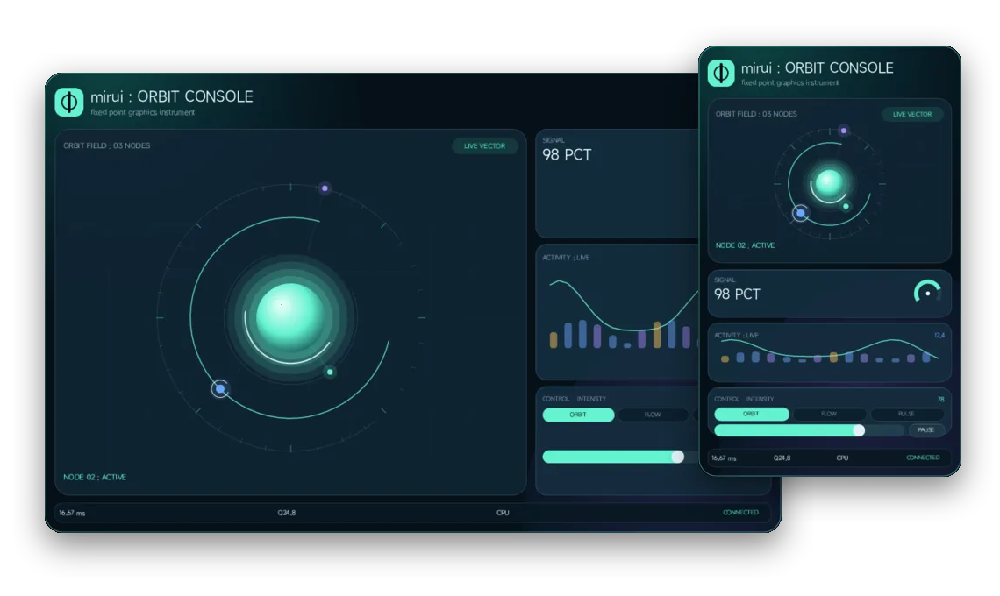

# mirui

[](https://crates.io/crates/mirui)
[](https://docs.rs/mirui)
[](LICENSE)

A `no_std`, ECS-driven UI framework for embedded, mobile, desktop, Linux, and WebAssembly targets. Layout, hit testing, and draw geometry use Q24.8 fixed point before submission to the software rasterizer, SDL GPU, WGPU, Web Canvas, framebuffer, DRM, and NuttX backends.



[Open mirui.rs](https://mirui.rs/) to run the browser demos, inspect their Rust source, and browse the Play applications. Run a native example with `cargo run -p gallery --example orbit_console_demo --release --features wgpu`.

## Features

- **ECS architecture** — entities, components, systems, resources, queries; system scheduler with named priority slots
- **`no_std` + `alloc`** — runs on bare-metal MCUs (ESP32-C3, STM32) with a global allocator
- **Subpixel rasterizer** — 24.8 fixed-point throughout (layout, rendering, hit-test, events). Scanline coverage AA on any `Path`; SDF / 2×2 supersample fast paths for quad fills
- **Vector drawing** — `Canvas` exposes `fill_path` / `stroke_path` / `draw_line` / `draw_arc`; `DrawCommand::FillPath` puts path fills inside the same View pipeline as built-in widgets
- **Typography** — shaped text supports bounded layout, fallback fonts, bidirectional scripts, path placement, oriented carets, selection geometry, and path-aware hit testing
- **Layout** — Flexbox, absolute positioning, padding, justify / align; `Dimension::{Px, Percent, Auto, Content}`
- **Animation** — Tween, Spring with critical damping, retargetable; typed `#[animate]` motion applicators and `#[timer]` callbacks
- **Theme** — `ColorToken` / `ThemedColor`; built-in dark / light + custom tokens; per-`WidgetState` (Hovered / Pressed / Error / Disabled) overlay routing
- **Interaction states** — hover, press, error, disabled propagated through ECS markers; system-level dispatch
- **Multi-touch** — pinch / rotate gesture recognition from raw pointer streams; `SimAction` for scripted multi-touch in tests
- **Input feedback** — opt-in `InputFeedbackPlugin` paints a cursor dot and a magnetic-membrane water drop responding to rotary / wheel / click input
- **Dirty-flag partial refresh** — only re-renders changed regions; per-entity `Dirty` + `PrevRect` machinery
- **HiDPI** — automatic scale factor propagation
- **Plugins** — bundle clocks, performance reporting, input feedback, and other cross-cutting behavior behind frame, input, suspend/resume, and shutdown hooks
- **Audio** — optional fixed-capacity commands, static scores, parameterized tones, integer PCM mixing, Web Audio and SDL sinks, and caller-owned embedded output
- **Pluggable backends** — software framebuffer, SDL2 CPU/GPU, WGPU, Web Canvas, Linux framebuffer/DRM, and NuttX; `compose_backend!` routes command classes through engines sharing one target
- **Declarative DSL** — `ui!` macro for nested widget trees with attributes, enchants, walk loops, conditionals

## Quick Start

```toml
[dependencies]
mirui = { version = "0.47", features = ["sdl"] }
```

```rust
use mirui::prelude::*;
use mirui::surface::sdl::SdlSurface;
use mirui::ui::widgets::{ParagraphStyle, Text};

fn main() {
    let backend = SdlSurface::new("hello mirui", 480, 320);
    let mut app = App::new(backend);
    app.with_default_widgets().with_default_systems();

    // Root fills the viewport with a Surface bg + Column layout by default.
    let root = app.spawn_root().id();

    app.compose(root, build_root());

    app.run();
}

#[compose]
fn build_root() {
    ui! {
        Column (grow: 1.0) {
            View (
                bg_color: ColorToken::Primary,
                text_color: ColorToken::OnPrimary,
                height: 40,
                border_radius: 8,
                padding: Padding::all(10)
            ) {
                Text ("Hello mirui!")
            }
            View (bg_color: ColorToken::SurfaceVariant, grow: 1.0)
            Text ("ECS + DSL", height: 30, paragraph: ParagraphStyle::label())
        }
    };
}
```

`mirui::prelude` brings `App`, layout types, `Color` / `Dimension` / `Fixed`, ECS roles, theme tokens, and the `ui!` / authoring macros. Surface backends, plugins, and individual widget kinds stay on their canonical paths so the prelude doesn't pin a platform or feature choice.

`#[compose]` creates a stack-held composition from application data. `app.compose(root, build_root())` executes it and returns its output. Call another compose function directly inside a widget tree, such as `status_row(model, "ready")`. Use `ui!(status_row(model, "ready"))` when invoking the same compose function from a composition body. `ui!(compose Name { ... })` defines a reusable niche-based View kind; it does not invoke a compose function.

### Other targets

The snippet above runs on the SDL backend. The same UI model runs in browsers through Web Canvas, on Android and iOS through WGPU or bounded software rasterization, on Linux framebuffer/DRM devices, on NuttX, and on bare-metal RISC-V or ARM Cortex-M MCUs through `FramebufSurface`. See [`docs/quickstart.md`](docs/quickstart.md) for the mobile, ESP32-C3, and multi-target workspace walkthrough.

[`docs/typography.md`](docs/typography.md) covers text paths, static and mutable geometry, reactive path selection, signal-derived curves, and handler-driven edits.

## MIRX assets

`gen-mirx image` converts common images through ICU and writes RAW, native pixel, RLE, LZ4, reversible frequency, or quantized frequency IMAGE storage. The generated bytes are reopened and preflighted with the same checked profiles consumed by `mirx::Reader` and mirui's texture loader. `--stride-align` applies only to stored RAW rows. Output geometry, input/output/workspace placement, workspace alignment, cache actions, and current host-slice address alignment use the same `DecodeRequest` vocabulary as FRAMES and `MirxTextureOptions`.

```shell
cargo xtask gen-mirx image --in logo.png --out logo.mirx --format rgba8888 --coding frequency-quantized --quality 75 --input-memory flash --output-align 64 --stride-multiple 64 --output-memory shared-noncoherent --workspace-align 64 --workspace-memory shared-coherent
```

`gen-mirx frames` accepts an ordered list of decoded source images, evaluates whole-frame, sparse-tile, previous-frame, RLE, native pixel, LZ4, reversible frequency, and optional quantized frequency candidates, then writes one checked FRAMES container. The output writer preserves declared source alignment at the final file address; decoded GPU/DMA geometry, memory placement, workspace alignment, and cache boundaries remain a runtime `DecodeRequest` choice.

```shell
cargo xtask gen-mirx frames --in frame-000.png --in frame-001.png --out animation.mirx --format rgba8888 --tile 32x32 --input-align 64 --input-memory flash --output-align 64 --stride-multiple 64 --output-memory shared-noncoherent --workspace-align 64 --workspace-memory shared-coherent
```

The frame generator prints the selected storage and coding for every frame, source-to-container ratio, loss policy, recovery bound, runtime path, stored input alignment and current host-slice address result, input/output/workspace placement, required cache actions, exact aligned canvas/workspace/backup sizes, required group slots, and every decoded plane's offset, stride, and allocation extent.

`Texture::from_mirx` keeps compatible RAW pixels borrowed and decodes compressed pixels into managed CPU storage. `Texture::plan_mirx` exposes exact group-slot, output, alignment, and reusable workspace requirements for fixed caller buffers. `MirxTextureOptions` carries `PayloadLimits` plus `DecodeRequest`, including execution intent, input/output/workspace placement, cache synchronization, and independent GPU/DMA width, stride, plane, base-address, and workspace constraints. Non-CPU output or workspace placement requires the explicit caller-buffer plan instead of the managed loader.

`MirxFontProvider::from_mirx_with_storage` reconstructs every encoded glyph surface once into a caller-owned static arena. `MirxFontStorage` separates persistent surface slots and decoded bytes from temporary group slots and codec workspace, so construction leaves no hidden per-glyph allocation and later glyph lookups return stable borrowed rasters. `SurfaceRequirements` applies the same address, plane, allocation extent, and stride constraints used by IMAGE and FRAMES; RAW glyph surfaces continue to borrow their original MIRX bytes.

```rust
use mirui::render::texture::{MirxTextureOptions, Texture};
use mirx::types::ByteAlignment;

let options = MirxTextureOptions::new()
    .with_base_alignment(ByteAlignment::new(64).unwrap())
    .with_plane_alignment(ByteAlignment::new(64).unwrap())
    .with_stride_multiple(64);
let texture = Texture::from_mirx_with(
    include_bytes!("logo.mirx"),
    options,
)?;
```

`MirxFramesPlan::open` validates the primary FRAMES timeline under the same `DecodeRequest` and reports encoded-address checks plus exact group-slot, aligned canvas, codec workspace, and restore-previous backup requirements. `bind(MirxFramesStorage { .. })` attaches named caller-owned buffers once; `MirxFramesSession::present` reuses them and returns a borrowed `Texture` for each requested frame. The plan and session expose required input invalidation and output cleaning at the platform cache boundary. `frame_at_ticks` and `present_at` resolve variable durations and finite or unbounded play counts directly from absolute sequence ticks without an allocated timing table.

`cargo run -p gallery --example mirx_frames_snapshot -- /tmp/mirx-frames.ppm` builds a compressed three-frame asset, plans flash input plus 64-byte shared output/workspace storage, reports the required non-coherent output cache action and actual host input alignment, selects frames by timeline tick, and writes a contact sheet while reusing one playback canvas.

## DSL Syntax

```rust
#[compose]
fn dashboard(items: &[Item], show_footer: bool) {
    ui! {
        // Widget with attributes
        Column (grow: 1.0) {
            Text ("Header", height: 40)
            View (grow: 1.0)
        }

        // Enchants — attach extra ECS components to the spawned entity
        View (width: 16, height: 16) [
            PhysicsBody { x: Fixed::ZERO, y: Fixed::ZERO },
            Velocity { vx: Fixed::from_int(1), vy: Fixed::ZERO },
        ]

        // Iteration
        walk items.iter() with item {
            Text (item.name, bg_color: item.color)
        }

        // Conditional
        if show_footer {
            Text ("visible")
        }
    };
}
```

Powered by [xrune](https://github.com/W-Mai/xrune). Integer literals in attributes (`height: 40`) coerce to `Fixed` / `Dimension` via `Into`.

Layout-responsive attributes declare the geometry they read. Bare `width` and `height` resolve against the nearest `container: true` ancestor; `id(name).width` and `id(name).height` reuse the existing named-ID registry. Up to 4 dependencies are stored inline, and undeclared values are rejected at compile time.

```rust
ui! {
    Column (container: true) {
        Text(
            "Adaptive title",
            font_size: @width {
                if width < Fixed::from_int(520) { 18_u16 } else { 30_u16 }
            },
            padding: @(width, height) {
                Padding::all(width.min(height) / 24)
            }
        )
    }
}
```

Use an alias when the expression should not expose an ID-shaped field: `@id(stage).width as stage_width { stage_width / 2 }`. `$` remains the signal-driven state binding syntax; `@` runs after layout geometry changes.

### Model roles

`#[model]` keeps business state in a registered instance. `#[observe]` marks
small values used by reactive attributes. `model!(T)` parameters and fields
carry a specific registered instance without exposing its generated handle
type:

```rust
use mirui::prelude::*;
use mirui::ui::widgets::{Button, Text};

#[model]
struct Counter {
    #[observe]
    value: i32,
}

#[model]
impl Counter {
    fn increment(&mut self) { self.value += 1; }
}

#[component]
#[derive(Clone)]
struct CounterTile {
    counter: model!(Counter),
}

#[compose]
fn counter_label(counter: model!(Counter), prefix: &'static str) -> Entity {
    ui! { Text(text: ${ format!("{prefix}: {}", counter.value()) }) }
}

#[compose]
fn counter_panel(counter: model!(Counter)) {
    ui! {
        Row {
            Button(text: "+") on Tap { counter.increment(); }
            counter_label(counter, "count")
        }
    };
}

fn install_counter<B, F>(app: &mut App<B, F>, root: Entity)
where
    B: Surface,
    F: RendererFactory<B>,
{
    let counter = app.add_model(Counter { value: 0 });
    app.compose(root, counter_panel(counter));
}
```

Use `#[component]` with `model!(T)` fields to attach registered model instances to entities. A typed `#[view(component = T)]` function declares its entity filter in the attribute, projects model fields through `model!(component.field)`, and subscribes only to selectors listed in `watch(...)`. `component!()` is only needed when the paint body also reads the component itself. One model can serve several Views; several instances of the same model type stay independent. A mutable model method may return `Result<Change, E>`; an error is returned without publishing reactive updates or effects. The [state guide](docs/state-management.md) covers Views, events, effects, systems, timers, ownership, and the update-path allocation boundary.

Views register widget kinds with independent paint, attach, gesture, observation, and system hooks. An empty `#[view]` function declares a behavior-only widget without generating a paint callback; `app.with_widget(function_name::view())` installs its declared hooks and systems. Paint priority affects drawing order, not gesture dispatch or system scheduling.

### Common attributes

| Attribute | Type | Description |
|-----------|------|-------------|
| `bg_color` / `text_color` / `border_color` | `Color` or `ColorToken` | Solid color or theme token |
| `text` | `&str` | Content of text-bearing widgets |
| `border_radius` / `border_width` | `Fixed` | Subpixel-accurate |
| `width` / `height` | `Dimension` | `Px / Percent / Auto / Content` |
| `grow` | `f32` | Flex grow factor |
| `direction` | `FlexDirection` | Row / Column |
| `justify` / `align` | `JustifyContent` / `AlignItems` | Axis alignment |
| `padding` | `Padding` | Inner padding |
| `position` | `Position` | Flex / Absolute |
| `left` / `top` | `Dimension` | Absolute position |
| `src` | `ImageSource` | Texture token or vector `Path` for `Image` |

## Theme

Built-in widgets read colours through `ColorToken`s. `Theme::light()` and `Theme::dark()` are ordinary editable palettes; `app.set_theme(...)` replaces the active theme and `app.edit_theme(...)` updates its tokens with one repaint.

```rust
let theme = Theme::dark()
    .with_info(ThemeInfo::new("ocean", "Ocean", "Low-glare cyan palette"))
    .with(ColorToken::Primary, Color::rgb(72, 214, 200));
app.register_theme(theme);
app.set_theme("ocean").unwrap();

assert_eq!(app.theme().id().as_str(), "ocean");
app.edit_theme(|theme| { theme.set(ColorToken::Primary, Color::rgb(96, 230, 214)); });
```

`WidgetState` (`Hovered` / `Pressed` / `Error` / `Disabled`) routes overlays automatically: hover blends 8% `OnSurface`, press 12%, error 16% `Error`, disabled blends text/icon to 38% on `Surface` and container roles to 12%. No widget needs to author per-state logic.

## Images

`Image` accepts resource names, vector paths, and typed `IconAsset` values through the same `src` field. Static geometry remains borrowed and is scaled during rendering without allocating transformed commands.

```rust
Image("avatar")
Image(src: ICON_HOME, color: ColorToken::Primary, viewbox: 24)
```

## Animation

```rust
use mirui::anim::{Spring, SpringConfig};

let mut spring = Spring::new(
    SpringConfig::new(220, 0.3),  // 220 ms perceptual duration, 30% bounce
    Fixed::ZERO,
);
spring.target(Fixed::from_int(100));
// driven each frame by the animation system
```

`#[animate]` generates a motion component and its system from typed roles. The
callback receives the current scalar through `motion!()` and may request
components, a model instance, the entity, or deferred commands:

```rust
#[component]
struct Opacity(Fixed);

#[animate(component = AnimateOpacity)]
fn apply_opacity(value: motion!(), opacity: component!(mut Opacity)) {
    opacity.0 = value;
}

app.add_system(AnimateOpacity::system());
```

`#[timer]` generates a reusable timer registration. Exactly one schedule is
declared with `after`, `every`, `repeat`, or `until`:

```rust
#[timer(every = 1_000)]
fn advance(counter: model!(Counter)) {
    counter.increment();
}

app.add_timer(advance::timer(counter));
```

## Plugins

Plugins package cross-cutting behaviour. Each plugin's docstring lists what it inserts so reading `add_plugin(...)` is enough to know what changes in `World`.

| Plugin | Inserts |
|--------|---------|
| `StdInstantClockPlugin` | resource: `MonoClock` (std-only) |
| `PerfReportPlugin` | resource: `PerfAccum`; hook: `post_render` |
| `FpsSummaryPlugin` | hook: `post_render` |
| `InputFeedbackPlugin` | resources: `InputFeedback`, `InputFeedbackInput`; systems: cursor + rotary feedback; views: cursor (pri 90), rotary (pri 91); entities: `OverlayCursor` (lazy), `OverlayRotary` (eager); hooks: `on_event`, `pre_render` |
| `AudioPlugin` (`audio` feature) | resources: `AudioHandle`, `AudioStateSignal`; hooks: `on_event`, `pre_render`, suspend, resume, quit |

Custom plugins implement `mirui::app::plugin::Plugin` and declare inserted resources, systems, Views, entities, and lifecycle hooks in their rustdoc. Plugin hooks are the low-level integration boundary. Widget events use `on` blocks or callbacks; lifecycle notifications and input fallback use `App::on_event` with named callback factories.

## ScrollView

```rust
#[compose]
fn item_list(items: &[Item]) {
    ui! {
        Scroll (grow: 1.0) {
            walk items.iter() with item {
                Text (item.label, height: 60, bg_color: item.color)
            }
        }
    };
}
```

`Scroll` clips its children and derives the retained content extent without a synchronization system. Virtualized or externally measured content can still provide explicit `ScrollConfig` dimensions. Drag scrolling, inertia, elastic bounce, nested scroll chaining, and per-axis content clamping share the same bounds calculation.

## Hybrid Backends — `compose_backend!`

Route selected command classes through accelerator engines while retaining one coherent output target:

```rust
use mirui_macros::compose_backend;

compose_backend! {
    pub struct Hybrid {
        sw: SwRenderer,
        blitter: DmaBlitEngine,
    }
    route {
        default => sw,
        blit => blitter,
    }
}

let renderer = Hybrid::new(sw_renderer, dma_blitter);
```

The default field owns the target. Every other field implements `RenderEngine<Target>` and receives a sequential mutable borrow for each routed request. Engine begin/end barriers surround submission, and target readback, scrolling, output scale, offscreen access, and flush remain target-owned. See `gallery/examples/backends/compose_backend_demo.rs`, `gallery/examples/backends/compose_backend_dsl.rs`, and the [exact backend fallback flow](docs/backend-fallback.md).

## ECS

Attach typed components to UI nodes and access their data through system parameters:

```rust
use mirui::prelude::*;

#[component]
struct PhysicsBody {
    position: Fixed,
}

#[component]
struct Velocity(Fixed);

struct MotionStep(Fixed);

#[compose]
fn build_scene() {
    ui! {
        View (width: 100, height: 100) [
            PhysicsBody {
                position: Fixed::ZERO,
            },
            Velocity(Fixed::ONE),
        ]
    };
}

#[system(order = Animation)]
fn physics_system(step: res!(MotionStep), bodies: query!(mut PhysicsBody, optional Velocity)) {
    for (body, velocity) in bodies {
        if let Some(velocity) = velocity {
            body.position += velocity.0 * step.0;
        }
    }
}

fn main() {
    let mut app = App::headless(320, 240);
    app.add_resource(MotionStep(Fixed::from_ratio(1, 60)));
    let root = app.spawn_root().id();
    app.compose(root, build_scene());
    app.add_system(physics_system::system());
}
```

System parameters declare their role with `model!`, `res!`, `query!`, or `commands!`; application systems do not receive `World`. `SystemSlot` names the standard scheduling positions (`SimInput / DeltaTime / InteractionState / Animation / Timer / ScrollInertia / LazyList / TabPages / Normal / PreRender`). Lower values run earlier; user systems default to `Normal`.

Typed queries support both iteration and `rows.get(entity)`. Point fetches
return `None` for missing or filtered rows and validate entity generations.
Mutable rows borrow the query exclusively until their references are released;
component-change notifications are shared with iteration.

## Performance

ESP32-C3 (RV32 160 MHz, no FPU) + ST7735S 128×128 SPI:

| Demo | frame avg | FPS | Notes |
|------|-----------|-----|-------|
| Three-body (widgets + dirty rect) | ~13 ms | ~77 | Default `quad-aa` off; partial refresh |
| Cover-flow (3D quad transforms) | ~52 ms | ~19 | `default-features = false` |

`App::run` writes a per-stage `FrameTimings` resource each frame (input / systems / layout / render / flush / seed_prev) and pushes `frame_nanos` into a 256-sample `FrameStats` ring for jitter / p99 analysis. `FpsSummaryPlugin` averages and prints the breakdown, `BudgetReportPlugin` warns when avg or p99 cross a configured threshold.

### Drilling into spans

Wrap any code with `mirui::trace_span!("name")` or annotate a fn with `#[mirui::trace_fn("name")]`. With a clock plugin installed (`StdInstantClockPlugin` on desktop, a custom one calling `mirui::core::perf::set_clock` on bare metal), every invocation records into a ring buffer that `mirui::core::perf::drain_events()` returns.

`mirui::core::perf::format_chrome_event` writes one event as Chrome trace JSON for [Perfetto](https://ui.perfetto.dev). On `std` `PerfReportPlugin::with_perfetto_writer` dumps the stream to a file. On ESP, the bundled `mirui-examples/examples/esp32c3-animation` demo prints `[trace] {...}` lines through `esp_println`; the host-side `tools/esp-trace.py` script collects them into a Perfetto-loadable JSON file.

## Hardware Examples

[mirui-examples](https://github.com/W-Mai/mirui-examples) hosts the ESP32-C3 demos:

- `demo-threebody` (default) — three gravitating bodies
- `demo-particles` — pulse rings, bouncing bars, particles
- `demo-subpixel` — bars moving by 1 px vs 0.1 px (subpixel AA)
- `demo-shapes` — clock face via `draw_line` / `draw_arc`
- `demo-butterfly` — flapping vector butterfly
- `demo-coverflow` — cover flow with 3D quad transforms
- `demo-flipcard`, `demo-gesture`, `demo-widgets` — additional showcases
- `demo-hidpi-downscale` / `demo-hidpi-upscale` — HiDPI mode toggles

Flash with `cargo run --release --features demo-XXX --no-default-features`.

## License

MIT
