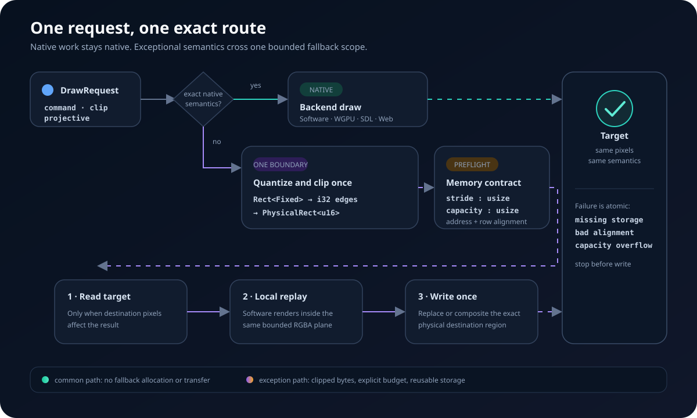

# Exact backend fallback

MIRUI classifies every checked draw before it changes the target. A backend
uses its native path only when that path preserves the complete request:
geometry, paint, clipping, compositing, filtering, and projection. Everything
else either enters an exact bounded fallback or returns a typed error.



## Route contract

`RenderRoute::Native` performs no fallback allocation, readback, or upload.
`RenderRoute::ExactFallback(FallbackRegion)` carries the physical destination
and row stride required by a prepared software replay. Planning completes
before target access, so missing storage, invalid alignment, and insufficient
capacity cannot leave a partially updated scope.

The fallback path has three transfers at most:

1. Read the clipped target region when the operation depends on existing
   destination pixels.
2. Replay the unsupported scope into the same region-local RGBA plane.
3. Write or composite that region back once.

Opaque isolated content can skip the first step when its blend semantics do
not depend on the destination. Consecutive operations that share ordering and
clip state stay inside one fallback scope instead of crossing the backend
boundary per command.

## Geometry and memory types

The types describe different boundaries and intentionally compose rather than
alias one another:

```text
Rect<Fixed>                     logical geometry with subpixels
└─ Viewport::physical_rect()
   └─ PhysicalRect<u16>         clipped integer destination pixels
      └─ FallbackRegion         destination pixels + RGBA row stride
         └─ PlaneLayout         local format, stride, size, alignment
            └─ AlignedPlane     validated caller-owned bytes
```

`PhysicalRect` is shared by surfaces, dirty flushes, target readback, mirror
copies, scrolling, and fallback routes. `FallbackRegion` remains separate
because only a fallback route promises a row layout and byte budget. Embedding
the full `PlaneLayout` in every retained route would repeat format, required
size, and alignment fields; scene replay can retain many routes on a small
target.

Numeric conversion follows one direction:

| Value | Type | Lifetime |
|---|---|---|
| layout, glyph, path, clip, affine transform | `Fixed` | until raster or viewport conversion |
| homography and projection intermediates | `Fixed64` | until projection validation |
| unclipped pixel edges and signed motion | `i32` | before target clipping |
| clipped physical origin and extent | `u16` in `PhysicalRect` | after clipping |
| stride, capacity, required bytes, slice offsets | `usize` | runtime memory only |
| MIRX dimensions, offsets, and stride | `u32` | stable wire representation |
| SDL/WGPU/Web coordinates | backend-required `u32` or `f64` | final host call only |

Logical bounds are scaled in `Fixed`; top and left are floored, bottom and right are ceiled; signed edges are clipped to the target; conversion to `u16` happens last. Empty logical bounds remain empty. Backends consume the resulting `PhysicalRect` and do not round it again. Web Canvas applies rectangular scissors in physical pixels; path clips retain their geometric coverage.

## Aligned caller storage

`PlaneRequirements` declares start-address and row-stride alignment. The
packed CPU default uses alignment 1. DMA, firmware, or GPU upload paths can
request aligned storage explicitly:

```rust
use mirui::render::{PlaneRequirements, ProjectiveFallback};

let requirements = PlaneRequirements::new(64, 64)?;
let fallback = ProjectiveFallback::borrowed_with(&mut bytes, requirements)?;
```

Planning rounds the minimum RGBA row size up to the requested stride alignment.
Binding checks the actual slice address, aligned stride, checked
`stride_bytes * height`, and available capacity. The same validated stride is
used for readback, software replay, and upload. The ordinary native route does
not inspect or carry this storage.

## Backend behavior

`Surface::persistence()` describes whether partial drawing can reuse pixels; it does not request continuous drawing. `Surface::needs_redraw()` reports content loss without consuming the request. App redraws on damage or invalidation, expands a needed transient frame to full coverage, and acknowledges the request only after successful submission. Window exposure can re-present retained software-upload textures without rasterizing the scene again.

`FrameRateCapPlugin` limits logical ticks after platform maintenance, including idle ticks and failed drawing attempts. It requires `MonoClock`; without the plugin or clock there is no implicit frame cap. Mobile hosts use its deadline for event-loop waits and run systems independently of window redraw requests. A platform redraw does not advance systems a second time. Web uses browser animation frames for scheduling.

SDL and WGPU device, presentation, multisampling, and upload-cache options are described in the [quick start](quickstart.md#desktop-sdl). Software-upload hosts configure raster resolution through `SoftwareUploadConfig::render_scale` and bound CPU pixel storage with `framebuffer_budget_bytes`. These are separate from GPU presentation latency and upload caches.

Linux DRM uses `LinuxDrmConfig::mode` to select a connector mode and `buffer_count` to allocate scanout buffers; the default is 2 buffers. A single buffer writes into the scanned framebuffer and can tear. Additional buffers consume pixel storage and do not raise the panel refresh rate. Gallery exposes the existing configuration through `MIRUI_DRM_MODE=640x480` and `MIRUI_DRM_BUFFERS=2`. Framebuffer and embedded surfaces retain their platform transfer and synchronization behavior; a logical tick cap does not change a display bus clock.

Compare processing times using the same scene, physical dimensions, build profile, presentation settings, and cache warm-up. Report average and tail frame times separately from presentation cadence. Readback, tracing, and synchronous logging add work to the measured path; exclude diagnostic captures when measuring ordinary interaction.

An `App` draw or submission failure leaves the last accepted widget bounds unchanged and requires a full redraw before framebuffer scroll transfers resume. Layout or surface acquisition failures before drawing preserve the existing framebuffer. Full and partial frames both use `RendererFactory::mirror_buffers` to synchronize writable rotating buffers after `Surface::end_flush` succeeds.

`Renderer::flush()` explicitly submits pending drawing and returns `Result<(), RenderError>`. `Canvas::flush()` carries the same error contract through canvas adapters and composed backends. App calls it after drawing and any frame readback, before flushing the surface. A submission failure is returned without accepting the frame baseline. Dropping a renderer releases resources without submitting pending work.

Software Blit execution acquires one validated source pixel borrow before sampling, including affine, quad and projective draws. Direct Canvas calls retain source-read failures until `flush()`; Renderer submission returns them immediately. Software fallback preserves these errors through the outer backend instead of treating the draw as successful or replacing the error with an unsupported-geometry result.

`Surface::begin_flush()` prepares the target before drawing. `flush(area)` transfers each physical region; `end_flush()` accepts the completed frame. These methods return `Result<(), RenderError>`. App calls `abort_flush()` on an unsuccessful frame and retains its pending damage. `SurfaceUnavailable` means acquisition can be retried; it is returned by explicit rendering and does not produce repeated tick warnings. `frame_end()` maintains platform completion and retained presentation retries, including idle and failed ticks. A successful submission does not generally mean the display has scanned the pixels. DRM waits for the flip event before exposing released buffers as mirror destinations; a timeout does not release them.

- Software writes directly into its framebuffer and normally needs no RGBA
  fallback plane.
- WGPU keeps supported projective geometry and glyph sampling native; exact
  destination-dependent operations use a clipped target edit on desktop.
- SDL GPU reads one clipped region into the configured aligned plane, performs
  local software replay, and uploads it with the same pitch.
- Web Canvas copies packed `ImageData` rows into the configured plane, replays
  locally, compacts only at the browser API boundary, and writes one
  `ImageData` region.

The public route result is semantic rather than predictive performance data.
A native route is preferred; fallback cost is proportional to the clipped
physical region and the number of backend crossings, not to the full surface
or glyph count.

## Retained widget outputs

`App::snapshot()` renders and presents a complete frame while copying its target pixels before the renderer releases the target. It uses the normal frame preparation and completion path without advancing systems or polling input. The returned `Texture` owns its pixels and retains the renderer's format and stride; encoders must inspect these rather than assume RGBA bytes. No root returns `Ok(None)`. Unsupported synchronous readback returns `RenderError::Unsupported(RenderFeature::Readback)` without rendering through a substitute backend. A readback error still allows a successfully drawn frame to be presented and its painted baseline to be recorded.

Pixel constructors (`Texture::new`, `from_ref`, `from_static`, `owned`, and `from_vec`) return `Result<Texture, RenderError>`. Empty dimensions, layout overflow, and short buffers return `InvalidTexture`; `owned` reports allocation failure as `ResourceLimit(Texture)`. `from_vec` takes ownership without copying, and `from_static` supports checked constant construction. Renderers propagate construction failures instead of exposing incomplete readback textures.

`Texture` does not implement `Clone`. Clone a cache handle to share its existing resource, borrow an output for immediate use, or request a frame/widget snapshot when an independent owned copy is required.

Use `texture.width()`, `height()`, and `format()` for resource metadata. `texture.pixels()` returns `Result<Option<TexturePixels>, RenderError>` without performing device work; `read_pixels()` returns a readable pixel borrow. The borrow exposes `bytes()`, `stride()`, and `get_pixel()`. Writable CPU storage uses `pixels_mut()` and its `bytes_mut()` / `set_pixel()` methods. `pixels_mut()` rejects read-only storage without allocating a copy. Each writable borrow advances the upload revision once; revision exhaustion disables caching. Padded CPU sources use checked `with_stride(stride)` construction.

```rust
use mirui::render::renderer::RenderError;
use mirui::render::texture::{ColorFormat, Texture};
use mirui::types::Color;

fn marker() -> Result<Texture<'static>, RenderError> {
    let mut texture = Texture::owned(16, 16, ColorFormat::RGBA8888)?;
    {
        let mut pixels = texture.pixels_mut()?;
        for y in 0..16 {
            pixels.set_pixel(8, y, &Color::rgb(32, 160, 224));
        }
    }
    Ok(texture)
}
```

Software, SDL GPU, native WGPU, and Web Canvas provide target readback. Browser WGPU does not provide synchronous readback. Frame snapshots read the actual render target; they do not include host window decorations or desktop composition. Explicit readback can allocate and synchronize with the GPU, so snapshot timing is not ordinary rendering performance.

`OffscreenRender` renders a widget subtree into a CPU texture and composites the completed result through the outer backend. Configure `app.with_offscreen_pool_budget(bytes)` before constructing output consumers; zero disables output storage and explicit offscreen nodes render inline. `OffscreenRender::with_scale(scale)` controls output resolution, and `with_opacity(alpha)` controls subtree composition. Subtree production uses the software renderer even when the outer backend uses a GPU.

Typed callbacks can declare `textures: res!(Outputs<WidgetTexture>)`, importing both types from `mirui::ui`. `textures.get(source)` returns a borrowed result whose `texture()` method exposes completed pixels. An unprepared or failed output returns `None`. Reading does not produce a source, subscribe to its changes, or change the Component-only `query!` contract. An explicit `OffscreenRender` attachment or an effect widget establishes the existing source request. `App::snapshot_widget(entity)` returns an owned copy when the pixels must outlive the callback borrow.

Each published texture also exposes `layout_rect()` in root layout coordinates and `local_bounds()` in logical units relative to that origin. Local bounds include borders, shadow and glow extents, and unclipped children; explicit child clips and scrolling viewports still use the layout rectangle. Capture dimensions round outward after scaling, and composition uses the same footprint without moving the layout-based transform pivot. These values exclude ancestor scrolling and external transforms and belong to the same successful output as the pixels. Moving a source preserves local history; changing its logical size, local footprint, or output scale clears incompatible history even when its pixel dimensions stay the same.

Ordinary outputs reuse one pixel slot. `TemporalMix` requests a second slot for its own history and reads `textures.previous(owner)`, frozen at the start of the drawing batch. Multiple dirty regions share that history; failed production does not advance it. First use and owners without retained history return `None`. History tracks successful outputs rather than adjacent input generations.

`paint.request_frame()` schedules one more visual update after successful painting. Requests within a captured subtree commit with that output; ordinary drawing commits after the complete main-target batch, including all dirty regions. Failed drawing discards its pending requests without cancelling other successfully published outputs. State and declared output dependencies already invalidate their Views without this call.

`TemporalMix` schedules updates while its blend and final composited output are changing. Integer rounding cannot leave a permanent residual. First use, unavailable sources, completed convergence, `mix=0` (current source), and `mix=255` (frozen output) do not schedule another frame.

Output consumers declare their sources on components. Registering a View filtered by that component activates the declarations; editing a source field rebinds the request, and removing the component releases it. Several effects on one entity keep independent source declarations. Implicit requests do not insert `OffscreenRender` or replace the consumer's transform.

Source changes and new publications invalidate each consumer according to its View's `invalidation` setting: `Visual` requests repainting, while `Layout` also requests layout. An existing visual invalidation does not prevent a layout consumer from receiving the stronger invalidation.

```rust
use mirui::{component, ecs::Entity, ui::WidgetTexture};

#[component]
struct Reflection {
    #[depends_on(WidgetTexture)]
    source: Entity,
}

#[component]
#[retain_previous(WidgetTexture)]
struct Feedback {
    #[depends_on(WidgetTexture)]
    source: Option<Entity>,
}
```

Field declarations accept `Entity` or `Option<Entity>`. A type-level `#[depends_on(T)]` requests the owner's current output; `#[retain_previous(T)]` requests owner history without creating a self-dependency. Each attribute accepts multiple output types. Conditional named fields retain their configuration gates; a tuple-field declaration cannot follow a conditionally removed field because its numeric position is not fixed.

`LayoutGeometry` publishes widget bounds without a texture. Declare `#[depends_on(LayoutGeometry)]` and read `res!(Outputs<LayoutGeometry>)`, importing both types from `mirui::ui`. `get(source)` returns a copyable snapshot: `border_rect()` and `content_rect()` use widget-local logical coordinates; `transform()` maps them to the screen, including ancestor scrolling and 2D/3D transforms; `clip()` is the screen-space intersection of ancestor clips and the viewport. Content bounds use resolved layout padding, including safe-area padding. Geometry is prepared before input and drawing, not while reading. Hidden, detached, deleted, or unprepared sources return `None`; an empty ancestor intersection retains geometry with an empty clip. Unchanged geometry retains its publication version. Only requested entities have records, with no pixel buffers or per-frame storage growth.

The output budget counts stored current and historical pixel slots, in-progress writes, and the shared Mirror/Shadow/Glow/TemporalMix workspace. Admission reserves these pixels before paint callbacks and preserves independent outputs on rejection. A 128×64 RGBA source and its reflection workspace need 64 KiB together. Sequential effects share the largest required workspace, including blur padding; it is released when no effect needs it. Offscreen captures also share retained software path and clip scratch, released when capture demand ends or on a memory warning. This raster scratch, the framebuffer, and metadata are outside the pixel budget. Unchanged inputs reuse completed pixels; changed outputs of the same size reuse their slots.

Widget textures contain local transparent RGBA pixels and never capture the parent framebuffer. Current dependencies and nested output boundaries determine production order, independently of sibling order or damage clipping. Composition applies the node's position, transform, scale, and group opacity; it does not produce textures. Cyclic output dependencies remain unavailable without executing the affected output callbacks. Completed sources remain valid if a dependent output or the final target fails.
