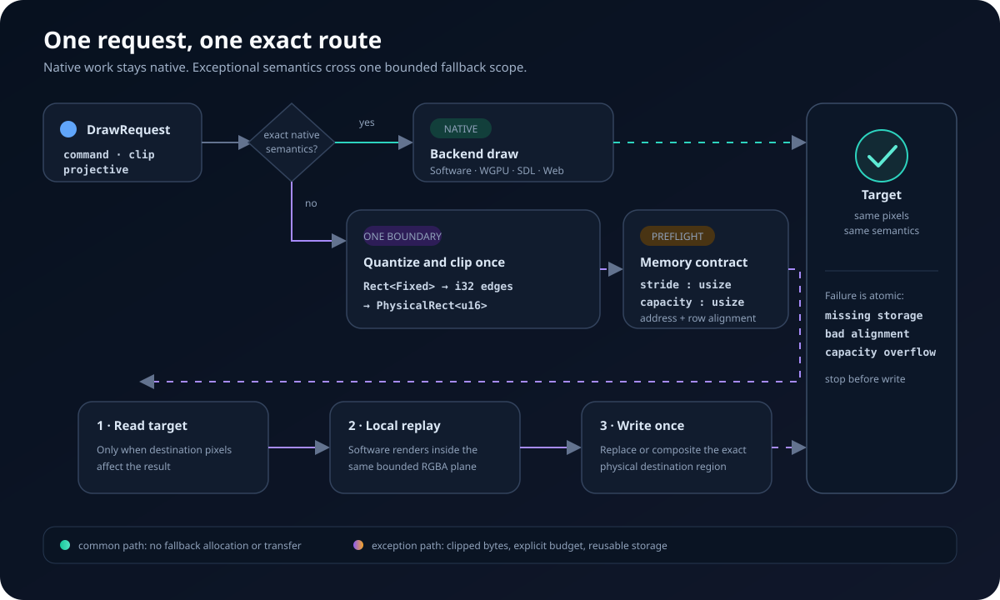

# 混合后端与软件回退 {#exact-backend-fallback}

`mirui` 在任何绘制命令真正修改目标像素之前，都会先行分类并校验其渲染路由（RenderRoute）。只有当某个硬件后端的原生路径能够**一字不差地完整保留**本次请求的几何形状、画刷（paint）、裁剪、混合模式、滤波与透视投影时，才会走原生硬件路径；其余任何超出硬件原生能力的操作，要么进入**有界局部软件回退（exact bounded fallback）**，要么直接返回结构化的 `RenderError`。



## 路由判定契约 (`RenderRoute`) {#route-contract}

- **`RenderRoute::Native`**：全程在硬件后端原生执行，零回退内存分配、零帧缓冲回读、零回写上传；
- **`RenderRoute::ExactFallback(FallbackRegion)`**：携带局部软件重放所需的物理目标矩形与按行对齐的字节跨距（row stride）。路由规划在触碰目标之前即已完成，因此工作区缺失、对齐不符或容量不足都会在修改任何像素前直接报错返回，绝不会留下半截残缺画面。

局部软件回退最多只发生三步数据传输：
1. **按需回读（Readback）**：仅当本次操作依赖目标上已有的背景像素（例如非不透明覆盖或复杂混合模式）时，将裁剪后的局部目标矩形回读到工作区；独立不透明覆盖可直接跳过此步；
2. **局部重放（Replay）**：在同一个局部 RGBA 平面（plane）中用软件光栅化器精确执行该作用域内的绘制命令；
3. **单次写回（Writeback）**：将完成的局部区域一次性写回或合成回硬件目标。连续共享顺序与裁剪状态的多条回退命令会合并在同一个回退作用域内完成，不会每条命令来回跨越后端边界。

软件后端自身也针对常见场景做了精确加速：
- 轴对齐或扫描线恒定颜色的线性渐变每行只求值一次；居中轴对齐径向渐变复用行内纵向距离平方；
- 渐变色标插值保持完整的 `Q48.16` 定点分数与精确整数舍入；
- `PaintCtx::with_clip_path` 在后端支持原生路径裁剪时直接走原生路径，否则通过 `plan_scope` 与 `render_scope` 在有界局部区域内精确执行。

## 几何与内存边界类型 {#geometry-and-memory-types}

从逻辑亚像素坐标到底层对齐字节切片，各层类型边界严密组合、各司其职：

```text
Rect<Fixed>                     带亚像素精度的逻辑几何矩形
└─ Viewport::physical_rect()
   └─ PhysicalRect<u16>         裁剪后的整数物理目标像素矩形
      └─ FallbackRegion         物理目标像素 + RGBA 行跨距 (stride)
         └─ PlaneLayout         局部像素格式、跨距、总字节数与对齐要求
            └─ AlignedPlane     经过校验的调用方自有字节切片
```

数值转换严格遵循单向收敛流水线：

| 数值阶段 | 类型 | 生命周期 |
| --- | --- | --- |
| 布局、字形、路径、裁剪与仿射变换 | `Fixed` | 直至进入光栅化或视口转换 |
| 单应性矩阵（Homography）与透视投影中间值 | `Fixed64` | 直至完成投影校验 |
| 未裁剪的像素边缘与有符号位移 | `i32` | 目标边界裁剪之前 |
| 裁剪后的物理起点与宽高 | `PhysicalRect` 中的 `u16` | 目标边界裁剪之后 |
| 行跨距、容量、所需字节数与切片偏移 | `usize` | 仅限运行时内存寻址 |
| MIRX 图像宽高、偏移与跨距 | `u32` | 稳定的跨平台序列化表示 |
| SDL / WGPU / Web 宿主 API 坐标 | 后端要求的 `u32` 或 `f64` | 仅在最终调用宿主 API 的边界处转换 |

逻辑矩形先在 `Fixed` 下缩放，左上角向下取整（floor）、右下角向上取整（ceil），再将有符号边缘裁剪到目标范围内，最后一步才转为 `u16`。

## 对齐的调用方工作区存储 (`PlaneRequirements`) {#aligned-caller-storage}

`PlaneRequirements` 声明起始地址对齐与行跨距（row stride）对齐。CPU 默认使用紧凑对齐（`1`）；DMA 传输、固件驱动或 GPU 上传路径则可显式请求对齐工作区：

```rust
use mirui::render::{PlaneRequirements, ProjectiveFallback};

let requirements = PlaneRequirements::new(64, 64)?;
let fallback = ProjectiveFallback::borrowed_with(&mut bytes, requirements)?;
```

规划阶段会将最小 RGBA 行字节数向上取整到所请求的跨距对齐倍数；绑定阶段则会校验切片起始地址、对齐跨距、`stride_bytes * height` 溢出以及可用容量，并在回读、软件重放与回写上传全程复用同一跨距。

## 渲染后端行为与脏区局部刷新 {#backend-behavior}

### 混合后端回退与脏区渲染流水线 {#backend-fallback-and-dirty-region-rendering}

<div class="arch-diagram" role="img" aria-label="脏区查询、物理重绘策略、表面刷新生命周期与多缓冲镜像同步">
  <svg viewBox="0 0 880 176" xmlns="http://www.w3.org/2000/svg">
    <defs>
      <marker id="bf-arrow" markerWidth="8" markerHeight="8" refX="7" refY="4" orient="auto">
        <path d="M0 0L8 4L0 8Z" fill="var(--site-blue-ink)" />
      </marker>
    </defs>
    <rect x="16" y="20" width="194" height="136" rx="12" fill="var(--site-panel)" stroke="var(--site-rule-strong)" />
    <text x="32" y="46" fill="var(--site-blue-ink)" font-family="var(--font-mono)" font-size="11" font-weight="600">01 · DAMAGE QUERY</text>
    <text x="32" y="70" fill="var(--site-ink)" font-family="var(--font-ui)" font-size="14" font-weight="620">失效收集与滚动平移</text>
    <text x="32" y="94" fill="var(--site-muted)" font-family="var(--font-mono)" font-size="11.5">app.dirty_regions()?</text>
    <text x="32" y="114" fill="var(--site-muted)" font-family="var(--font-mono)" font-size="11.5">Surface::persistence()</text>
    <text x="32" y="138" fill="var(--site-faint)" font-family="var(--font-ui)" font-size="11">逻辑脏矩形 + 滚动像素拷贝</text>
    <path d="M210 88H248" stroke="var(--site-blue-ink)" stroke-width="1.5" marker-end="url(#bf-arrow)" />
    <rect x="256" y="20" width="194" height="136" rx="12" fill="var(--site-panel)" stroke="var(--site-rule-strong)" />
    <text x="272" y="46" fill="var(--site-blue-ink)" font-family="var(--font-mono)" font-size="11" font-weight="600">02 · REDRAW PLAN</text>
    <text x="272" y="70" fill="var(--site-ink)" font-family="var(--font-ui)" font-size="14" font-weight="620">物理脏区分组策略</text>
    <text x="272" y="94" fill="var(--site-muted)" font-family="var(--font-mono)" font-size="11.5">Adaptive (稀疏保留 / 密集合并)</text>
    <text x="272" y="114" fill="var(--site-muted)" font-family="var(--font-mono)" font-size="11.5">BoundingBox (单外接矩形)</text>
    <text x="272" y="138" fill="var(--site-faint)" font-family="var(--font-ui)" font-size="11">裁剪后的 PhysicalRect&lt;u16&gt;</text>
    <path d="M450 88H488" stroke="var(--site-blue-ink)" stroke-width="1.5" marker-end="url(#bf-arrow)" />
    <rect x="496" y="20" width="194" height="136" rx="12" fill="var(--site-panel)" stroke="var(--site-rule-strong)" />
    <text x="512" y="46" fill="var(--site-blue-ink)" font-family="var(--font-mono)" font-size="11" font-weight="600">03 · FLUSH LIFECYCLE</text>
    <text x="512" y="70" fill="var(--site-ink)" font-family="var(--font-ui)" font-size="14" font-weight="620">受控表面刷新传输</text>
    <text x="512" y="94" fill="var(--site-muted)" font-family="var(--font-mono)" font-size="11.5">begin_flush() → flush(area)</text>
    <text x="512" y="114" fill="var(--site-muted)" font-family="var(--font-mono)" font-size="11.5">end_flush() / abort_flush()</text>
    <text x="512" y="138" fill="var(--site-faint)" font-family="var(--font-ui)" font-size="11">Renderer::flush() 先于表面提交</text>
    <path d="M690 88H728" stroke="var(--site-blue-ink)" stroke-width="1.5" marker-end="url(#bf-arrow)" />
    <rect x="736" y="20" width="128" height="136" rx="12" fill="var(--site-panel)" stroke="var(--site-rule-strong)" />
    <text x="752" y="46" fill="var(--logo-see)" font-family="var(--font-mono)" font-size="11" font-weight="600">04 · MIRROR</text>
    <text x="752" y="70" fill="var(--site-ink)" font-family="var(--font-ui)" font-size="14" font-weight="620">多缓冲镜像同步</text>
    <text x="752" y="94" fill="var(--site-muted)" font-family="var(--font-mono)" font-size="11.5">mirror_buffers</text>
    <text x="752" y="114" fill="var(--site-muted)" font-family="var(--font-mono)" font-size="11.5">shifts + redraw</text>
    <text x="752" y="138" fill="var(--site-faint)" font-family="var(--font-ui)" font-size="11">轮换扫描缓冲同步</text>
  </svg>
</div>

`Canvas::clear(&PhysicalRect, &Color)` 直接替换目标矩形内的像素（不混合、不抗锯齿、不经过逻辑缩放）。`DrawRequest::with_physical_clip(area)` 将绘制写入严格限制在当前目标的指定整数物理像素矩形内，而不移动几何位置或改变纹理坐标。

### 脏区计算与局部刷新 (`Dirty regions and partial flush`) {#dirty-regions-and-partial-flush}

`App` 拥有其重构的帧像素：重绘区域在带透明通道的目标上先清空为全透明零，在不透明目标上清空为黑色，然后正常绘制根节点背景；滚动平移（scroll transfer）最先执行，被平移复用的像素不会被清空。

当使用双缓冲或多缓冲轮换（如 Linux DRM 扫描输出缓冲）时，`RendererFactory::mirror_buffers(backend, plan, redraw, viewport)` 接收本帧实际重绘的精确物理区域：多缓冲工厂会先对非活动缓冲区应用 `plan.shifts` 平移，再将 `redraw` 脏区拷贝过去，从而让所有轮换缓冲区保持像素一致。

- `Surface::persistence()` 描述表面是否保留上一帧像素以支持局部重绘；
- `Surface::needs_redraw()` 汇报窗口暴露或内容丢失（`App` 会自动将该帧扩展为全屏重绘，并在提交成功后才确认清除该请求）；
- `Surface::redraw_strategy()` 选择物理脏区分组策略：默认的 `Adaptive` 保留稀疏独立脏矩形并合并密集区域；`BoundingBox` 则取非空脏区的总外接矩形以减少树遍历次数。

### 各后端特性与配置 (`Backend capabilities`) {#backend-capabilities}

- **单重采样 SDL-GPU 窗口**：在支持渲染目标纹理时保留一张与窗口物理尺寸相同的 RGBA 目标纹理并采用 `BoundingBox` 策略（每物理像素 4 字节，无需分配 CPU 帧缓冲）；多重采样窗口（如默认 4× OpenGL）则直接绘制窗口目标并在出现脏区时整帧重绘。
- **`FrameRateCapPlugin`**：配合 `MonoClock` 在平台维护后限制逻辑 tick 频率（详细设备与多采样选项参阅[环境搭建与多端工程](quickstart.md#desktop-sdl)）。
- **Linux DRM**：通过 `LinuxDrmConfig::mode` 选择显示器连接器模式，通过 `buffer_count` 分配扫描输出缓冲（默认为 2，Gallery 支持通过 `MIRUI_DRM_MODE=640x480` 与 `MIRUI_DRM_BUFFERS=2` 配置）。

### 局部区域编辑与刷新生命周期 (`Region edits and flush lifecycle`) {#region-edits-and-flush-lifecycle}

`Renderer::flush()` 显式提交挂起的绘制命令并返回 `Result<(), RenderError>`。随后表面依次执行：
1. `Surface::begin_flush()`：在写入前准备目标；
2. `Surface::flush(area)`：传输每一个物理脏矩形；
3. `Surface::end_flush()`：确认接受已完成的帧（若中途失败则调用 `abort_flush()` 并保留待处理脏区以便重试）；
4. `Surface::frame_end()`：维护平台完成状态与呈现重试（Linux DRM 会等待内核 flip 事件完成后才将释放的旧缓冲区重新作为镜像目标暴露）。

四大后端的局部回退路径对比：
- **Software（纯软件后端）**：直接写入自有帧缓冲，通常无需额外的 RGBA 回退平面；
- **WGPU**：透视几何与字形采样保持原生 GPU 执行；桌面端遇到依赖目标像素的精确复合操作时，使用受 `with_target_edit_budget` 约束的裁剪目标编辑平面；
- **SDL-GPU**：将裁剪后的单个区域读入配置的对齐 `ProjectiveFallback` 平面，在本地完成软件重放后以相同跨距上传回纹理；
- **Web Canvas**：将紧凑的 `ImageData` 行拷入工作平面重放，仅在浏览器 API 边界处压缩并写回单个 `ImageData` 区域。

## 保留的控件离屏输出 (`Retained widget outputs`) {#retained-widget-outputs}

`App::snapshot()` 在渲染并呈现完整一帧的同时，赶在渲染器释放目标前拷贝一份拥有独立像素所有权的 `Texture`。而日常控件级离屏捕获则通过 `Outputs<WidgetTexture>` 在 `with_offscreen_pool_budget(bytes)` 账本下统一管理。

### 纹理上传与几何网格缓存 (`Upload and geometry caches`) {#upload-and-geometry-caches}

- **图像上传缓存**：SDL、WGPU 与 Web Canvas 在缓存未命中时通过经过校验的像素借用读取源纹理（紧凑 RGBA 直接借用切片，每次可写借用递增一次上传修订号）；
- **标量字形与路径细分缓存**：SDL 与 WGPU 共享字形缓存键与经过校验的路径三角剖分（tessellation），可通过工厂的 `trim_memory()` 一键释放空闲缓存；
- **SDL-GPU 渐变硬件加速**：最多 16 个严格递增色标的仿射线性渐变直接使用原生顶点色绘制（单批次最多 768 个顶点）；内径为 0 的居中径向渐变则生成归一化线性滤波 GPU 调色板纹理（与图像上传共享默认 16 MiB 的纹理缓存预算与 LRU 淘汰策略）。

### 无需 CPU 回读的跨控件输出合成 {#composing-an-output-without-cpu-access}

通过在自定义组件字段上声明 `#[depends_on(WidgetTexture)]`，消费者控件可以在自己的 `#[view]` 中直接通过 `res!(Outputs<WidgetTexture>)` 采样另一个控件的离屏输出纹理，**全程无需将其回读到 CPU**：

```rust
use mirui::prelude::*;
use mirui::render::{DrawCommand, RenderError, SamplerConfig};
use mirui::ui::{Outputs, WidgetTexture};

#[component]
struct Preview {
    #[depends_on(WidgetTexture)]
    source: Entity,
}

#[view(component = Preview)]
fn preview(
    preview: &Preview,
    outputs: res!(Outputs<WidgetTexture>),
    paint: paint!(),
) {
    let Some(output) = outputs.get(preview.source) else {
        return;
    };
    paint.draw(&DrawCommand::Blit {
        rect: paint.rect(),
        texture: output.texture(),
        sampler: SamplerConfig::default(),
        opacity: 255,
    });
}
```

### 离屏输出几何边界与历史帧 (`#[retain_previous]`) {#output-geometry-and-history}

每个已发布的 `WidgetTexture` 同时暴露根布局坐标系下的 `layout_rect()` 以及包含边框、阴影、发光与未裁剪子节点的局部外接范围 `local_bounds()`。对于需要跨帧混合的效果（如 `TemporalMix` 残影混合），在组件上标注 `#[retain_previous(WidgetTexture)]` 即可请求保留自身上一帧成功产出的历史纹理，并通过 `outputs.previous(owner)` 读取：

```rust
use mirui::{component, ecs::Entity, ui::WidgetTexture};

#[component]
struct Reflection {
    #[depends_on(WidgetTexture)]
    source: Entity,
}

#[component]
#[retain_previous(WidgetTexture)]
struct Feedback {
    #[depends_on(WidgetTexture)]
    source: Option<Entity>,
}
```

若某个自定义效果只需要目标控件的屏幕几何位置与裁剪区域而不需要像素纹理，可改为声明更轻量的 `#[depends_on(LayoutGeometry)]` 并读取 `res!(Outputs<LayoutGeometry>)`——全程不分配任何像素缓冲。
