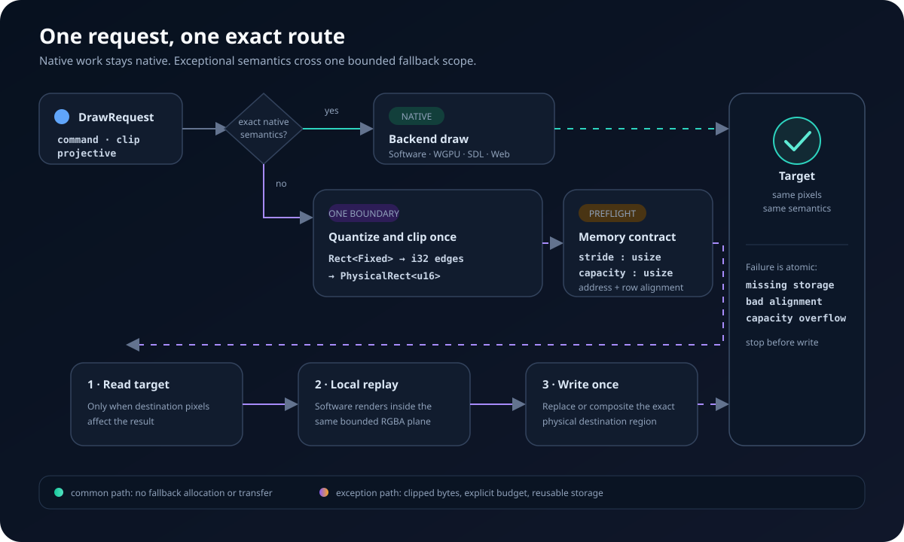

# 字体栈与曲线排字 {#typography}

mirui 先将文本整形（shaping）为带位置的字形（glyph），随后可按需将这些字形排布到已注册的矢量路径上。同一套 `Path` 与 `PathId` 类型同时驱动矢量绘制、裁剪、命中测试与文本基线。

<MiruiSnippet recipe="curve" label="TextPath" file="recipes.rs" height="230px">

<<< @/examples/first-app/src/recipes.rs#recipe-curve{rust}

<template #exercise>

点击 `Slide +18` 沿贝塞尔曲线推进起始偏移，或点击 `Flip wave` 在波峰与波谷路径之间切换响应式 `TextPath`。

</template>

</MiruiSnippet>

<div class="arch-diagram" role="img" aria-label="从字体栈与文本整形到线性或路径字形排布的排版管线">
  <svg viewBox="0 0 880 168" xmlns="http://www.w3.org/2000/svg">
    <defs>
      <marker id="typo-arrow" markerWidth="8" markerHeight="8" refX="7" refY="4" orient="auto">
        <path d="M0 0L8 4L0 8Z" fill="var(--site-blue-ink)" />
      </marker>
    </defs>
    <rect x="16" y="20" width="194" height="128" rx="12" fill="var(--site-panel)" stroke="var(--site-rule-strong)" />
    <text x="32" y="46" fill="var(--site-blue-ink)" font-family="var(--font-mono)" font-size="11" font-weight="600">01 · FONT STACK</text>
    <text x="32" y="70" fill="var(--site-ink)" font-family="var(--font-ui)" font-size="14" font-weight="620">主字体 + 回退栈</text>
    <text x="32" y="94" fill="var(--site-muted)" font-family="var(--font-mono)" font-size="11.5">FontToken::Default</text>
    <text x="32" y="114" fill="var(--site-muted)" font-family="var(--font-mono)" font-size="11.5">FontToken::FALLBACK</text>
    <text x="32" y="134" fill="var(--site-faint)" font-family="var(--font-ui)" font-size="11">MIRX A1 / A8 / SDF 字形图集</text>
    <path d="M210 84H248" stroke="var(--site-blue-ink)" stroke-width="1.5" marker-end="url(#typo-arrow)" />
    <rect x="256" y="20" width="194" height="128" rx="12" fill="var(--site-panel)" stroke="var(--site-rule-strong)" />
    <text x="272" y="46" fill="var(--site-blue-ink)" font-family="var(--font-mono)" font-size="11" font-weight="600">02 · SHAPING</text>
    <text x="272" y="70" fill="var(--site-ink)" font-family="var(--font-ui)" font-size="14" font-weight="620">双向文本与断行</text>
    <text x="272" y="94" fill="var(--site-muted)" font-family="var(--font-mono)" font-size="11.5">TextWrap · Ellipsis</text>
    <text x="272" y="114" fill="var(--site-muted)" font-family="var(--font-mono)" font-size="11.5">TextLayoutCapacity</text>
    <text x="272" y="134" fill="var(--site-faint)" font-family="var(--font-ui)" font-size="11">有界工作区缓冲区</text>
    <path d="M450 84H488" stroke="var(--site-blue-ink)" stroke-width="1.5" marker-end="url(#typo-arrow)" />
    <rect x="496" y="20" width="186" height="128" rx="12" fill="var(--site-panel)" stroke="var(--site-rule-strong)" />
    <text x="512" y="46" fill="var(--site-blue-ink)" font-family="var(--font-mono)" font-size="11" font-weight="600">03 · PLACEMENT</text>
    <text x="512" y="70" fill="var(--site-ink)" font-family="var(--font-ui)" font-size="14" font-weight="620">矩形框或贝塞尔路径</text>
    <text x="512" y="94" fill="var(--site-muted)" font-family="var(--font-mono)" font-size="11.5">TextPath::with_offset</text>
    <text x="512" y="114" fill="var(--site-muted)" font-family="var(--font-mono)" font-size="11.5">Outputs&lt;TextGeometry&gt;</text>
    <text x="512" y="134" fill="var(--site-faint)" font-family="var(--font-ui)" font-size="11">切向坐标架与光标段</text>
    <path d="M682 84H720" stroke="var(--site-blue-ink)" stroke-width="1.5" marker-end="url(#typo-arrow)" />
    <rect x="728" y="20" width="136" height="128" rx="12" fill="var(--site-panel)" stroke="var(--site-rule-strong)" />
    <text x="744" y="46" fill="var(--logo-see)" font-family="var(--font-mono)" font-size="11" font-weight="600">04 · RASTER</text>
    <text x="744" y="70" fill="var(--site-ink)" font-family="var(--font-ui)" font-size="14" font-weight="620">光栅化与命中测试</text>
    <text x="744" y="94" fill="var(--site-muted)" font-family="var(--font-mono)" font-size="11.5">选区视觉段</text>
    <text x="744" y="114" fill="var(--site-muted)" font-family="var(--font-mono)" font-size="11.5">有向光标</text>
    <text x="744" y="134" fill="var(--site-faint)" font-family="var(--font-ui)" font-size="11">SW / GPU / Web</text>
  </svg>
</div>

## 默认字体与提供方 {#default-font-and-providers}

`Font::default()` 打开内嵌的 8 px ASCII MIRX 字体，其 A1 字形图集直接借用自程序只读存储。`font_size` 同时缩放字体度量与绘制尺寸。除非字体栈提供了额外字形覆盖，否则 ASCII 以外的字符会回退显示为该字体的问号字形。需要更多字符集的应用可通过 `App::with_fonts` 注册其他 MIRX 字体。

`font`、`font_stack`、`font_size` 与 `text_color` 沿 UI 父子链向下继承，每个字段各自取最近的祖先声明值。根节点默认使用默认字体栈、所选字体的原生字号以及 `ColorToken::OnSurface`。若子树继承了其他字号，可显式指定 `font_size: FontSize::Native` 以恢复所选字体的原生字号。段落排版属性（`paragraph`）在每个文本控件上单独指定。自定义绘制回调可通过 `paint.typography()` 读取最终生效的排版参数。

包括内嵌字体在内，所有字体均通过 `FontProvider` 接口访问。自定义提供方保存在 `Font` 的 `provider: Rc<dyn FontProvider>` 字段中；克隆 `Font` 会共享同一个提供方。软件渲染器与硬件加速渲染器消费相同的光栅区域与覆盖率元数据。软件渲染器直接读取原尺寸 A1 覆盖率，并在缩放时重采样覆盖率数据。

## 文本框溢出 {#text-box-overflow}

`LF`、`CR` 与 `CRLF` 用于分隔段落行，自身不会请求字体覆盖或生成字形。开头、连续或末尾的换行符会保留空行及其对应的光标位置。文本、选区与剪贴板偏移量均直接对应原始 UTF-8 字节；`CRLF` 的两个字节之间不存在光标位置。`TextEditing` 保持单行显示，在水平方向移动光标或删除时会一次性跨过整个 `CRLF` 字节对。

当文本需要自动换行或显示省略号时，请为控件指定有限宽度。使用 `Ellipsis` 还要求字体栈中至少有一款字体映射了 `U+2026`（`…`）。在显式指定尺寸的轴向上，普通 `Text` 在两种溢出策略下都会裁剪到变换后的文本框内；而 `Auto` 与 `Content` 尺寸则会在祖先裁剪区域内保留字形墨迹外延（ink overhang）。路径文本因为字形墨迹可能延伸出布局框之外，始终使用其排布后的字形几何与祖先裁剪区域。

```rust
ui! {
    Text(
        "A long status label",
        width: Dimension::percent(100),
        paragraph: ParagraphStyle {
            wrap: TextWrap::NoWrap,
            max_lines: Some(1),
            overflow: TextOverflow::Ellipsis,
            ..ParagraphStyle::default()
        }
    )
};
```

## 布局失败报告 {#layout-failure-reporting}

当文本准备失败（包括 `TextInput` 正文与占位符）时，`App::render()` 与 `App::render_dirty()` 会返回 `RenderError::TextLayout`。当前帧的绘制、滚动拷贝与帧缓冲刷写都会被跳过。调用 `App::last_text_layout_failure()` 可查看具体的文本实体、失败所处的准备阶段以及可用容量详情；后续一旦布局成功，该诊断信息会自动清空。

`TextEditing` 会在自身最终尺寸确定后准备单行文本布局。绘制阶段由字形与光标直接读取该布局；输入编辑、占位符变更、通过 `App::with_fonts` 替换字体以及重置缓存都会触发重新准备。空输入框将光标保持在起始位置；超长内容则会水平滚动以确保光标始终处于可见区域内。

底层调用方可使用 `render_system::try_update_layout` 捕获布局错误并在绘制前提前中止。`collect_dirty_region` 与 `collect_dirty_regions` 同样返回携带 `TextLayoutFailure` 的 `Result`；`App::dirty_region()` 会将该错误映射为 `RenderError::TextLayout`。成功查询出空脏区与布局失败是截然不同的两种结果。布局失败还会向 `World` 记录 `TextLayoutFailure` 资源并使已缓存的几何失效以便下次重试，但不会恢复在本次准备过程中已被淘汰的文本缓存条目。

`App` 在全量或增量渲染成功后记录已绘制边界。底层自定义渲染循环应在成功完成绘制后、发生进一步状态变更前调用 `render_system::seed_prev_rects`；仅收集脏区不会将该帧标记为已绘制。

## 有界动态文本内容 {#bound-dynamic-content}

`capacity` 为 `Text` 或 `Button` 标签预留固定字节数的 UTF-8 内容存储。响应式表达式可以直接在栈缓冲区中完成格式化，再将完整结果拷入该预留存储，从而在更新文本内容时实现零堆分配：

```rust
#[compose]
fn reading_label(reading: Signal<u16>) {
    ui! {
        Text(text: ${ format_args!("{:03}", reading.get()) }, capacity: 4)
    };
}
```

`capacity` 统计的是 UTF-8 字节数而非字符数。若新值超出容量或格式化失败，控件会保留上一次的有效内容，并在 `Text` 组件上记录 `TextContentError`。如果首帧初始值即告失败，`App::render()` 与 `App::render_dirty()` 会在绘制或刷写前直接返回 `RenderError::TextContent`。`App::last_text_content_failure()` 会返回出错实体与具体错误，并优先上报尚未获得合法初始值的标签。后续只要有一次合法更新即可清除该诊断状态。已有合法初始值后，运行期发生内容溢出不会阻断界面其余部分的正常渲染。

有界写入仅涵盖 `Text` 内部执行的存储与格式化过程；若表达式本身写成了 `format!(...)`、`.to_string()` 或克隆了 `Signal<String>`，则在进入有界写入前仍可能发生堆分配。当要求更新过程严格零分配时，请对借用值或标量值使用 `format_args!`。文本整形、排版布局、字体缓存与后端资源各自拥有独立的容量限制。有界内容存放的是纯文本值；若标签需要随语言环境（locale）动态切换，请使用现有的本地化文本路径。

## 预留有界排版存储 {#reserve-bounded-layout-storage}

`App::with_text_layout_capacity` 在首次执行布局传递前预分配文本缓存存储。当默认字节预算不适用时，请先设置 `TextLayoutLimits`。若调用返回错误，原先安装的缓存保持不变；在文本布局已经启动后再调用该方法会返回 `TextLayoutError::InUse`。`App::try_with_text_layout_limits` 也支持在完成容量预留之后、首次布局开始之前调整限制参数并保留已声明的容量；若新限制与已预留容量不兼容，则返回错误且不替换原缓存。流式方法 `with_text_layout_limits` 在遇到不兼容限制时会直接 panic，而不会静默移除容量上限。

```rust
use mirui::text::{TextLayoutCapacity, WorkspaceCapacity};

app.with_text_layout_capacity(TextLayoutCapacity {
    layout_slots: 4,
    measurements: 4,
    lines: 16,
    runs: 32,
    glyphs: 64,
    carets: 64,
    workspace: WorkspaceCapacity {
        runs: 16,
        glyphs: 32,
        scratch_glyphs: 32,
        lines: 16,
    },
})?;
```

`layout_slots` 涵盖保留的布局句柄及其代际（generation）存储。行（`lines`）、字形段（`runs`）、字形（`glyphs`）与光标（`carets`）容量涵盖所有常驻段落加上当前正在排版段落的临时输出——它们是全局总量上限，不同于 `TextLayoutLimits` 中的单段落上限。`workspace` 约束私有整形缓冲区的大小。预留操作会校验实际保留的向量容量与工作区之和是否未超出 `TextLayoutLimits::cache_bytes`。后续运行中一旦请求超出已声明的容量，将显式报错失败，而不会动态扩容这些缓冲区。渲染器与字体缓存各自拥有独立的存储空间。

可复用的 UI 模块可以在初始化阶段通过 `App::require_text_layout_capacity` 声明自身的 `module_text_capacity: TextLayoutCapacity`。各模块的布局槽位、测量项、行、字形段、字形与光标需求会累加计算；整形工作区因为全局复用同一块暂存区，会在各模块需求之间取最大值。当所有模块组装完毕后，请在首次布局传递前调用 `App::prepare_text_layout`：

```rust
app.require_text_layout_capacity(module_text_capacity)?;
// 先组装其余 UI 模块，随后统一准备共享缓存。
app.prepare_text_layout()?;
```

声明需求阶段不会立即替换缓存；调用 `prepare_text_layout` 时才会对照当前字节预算校验汇总后的容量需求，若失败则保留原缓存不动。在布局启动后调用、或将累加式需求与 `with_text_layout_capacity` 混用都会返回错误，以免冲掉其他模块的预留配额。`App::render()` 与 `App::render_dirty()` 在进入布局前也会自动准备待生效的容量需求；若准备失败则返回 `RenderError::TextPreparation`，可通过 `App::last_text_layout_preparation_error()` 查询原因。自行控制启动流程的应用应当显式调用 `prepare_text_layout`，以便在进入帧循环前捕获配置错误。若未启用任何容量预留，文本布局保持原有的按需分配行为。

在 Web Canvas 后端上，示例或应用可以在启动阶段提供未变换、1× 缩放下单条字形段（run）的墨迹范围提示：

```rust
app.prefer_text_raster_scratch(256, 8)?;
```

`App` 会取所有提示中的最大宽高，并在每帧开始前结合当前视口缩放比准备光栅化槽位。槽位数量按已构建的有界 `Text` 控件数量分配；每个槽位各自保留其 RGBA 缓冲区、离屏 Canvas、`ImageData` 及像素视图。每个槽位归属一条文本字形段：内容未变时直接复用已光栅化的图像，内容改变时在同一槽位内原地重绘，不会挤占其他字形段的槽位。所有槽位共享同一块软件光栅化暂存区。单代（generation）请求的 RGBA 总字节数上限为 8 MiB；另有独立的 8 MiB 预检额度，用于在视口缩放重建期间同时容纳旧代与新代的 RGBA 缓冲及槽位元数据。字形缓存（glyph cache）拥有自身独立的 8 MiB 标称画布像素上限，二者不共用同一个合并预算。暂存区检查约束的是受管 Rust 请求大小，而非底层分配器实际开销或浏览器堆内存占用。视口放大或新增有界文本控件可能需要更多存储。若准备失败，旧槽位继续可用，新增或超出的部分按需回退到字形缓存路径绘制，并可通过 `App::last_text_raster_scratch_preparation_error()` 读取错误详情。因几何尺寸或预算预检被拒绝的相同请求不会在每一帧重复尝试重建。对象池构建失败后，两次重试之间最多跳过 64 次准备调用；请求参数改变或调用 `trim_memory` 会重置失败状态。内存裁剪（memory trim）会在下次准备前释放保留的暂存区以及字形/纹理池。静态文本与超出预置范围的字形段继续走原有的字形缓存路径；该提示并非硬性容量上限，也不构成零资源增长保证。单个有界 `Text` 可能产生多条布局字形段；当活跃字形段身份超出预置槽位数时，新字形段按最近最少使用（LRU）策略淘汰旧槽位。`capacity` 仅限制 UTF-8 文本字节数，不限制光栅化像素尺寸；带几何变换的文本也可能超出提示尺寸。

`WebCanvasRendererFactory::text_resource_stats()` 详细区分了暂存池准备尝试次数与失败次数、保留槽位命中次数、重绘次数、字形段淘汰次数，以及因超出条件而回退创建字形缓存表面的有界字形段次数。准备计数器仅统计实际发起的新池构建尝试，不包含命中缓存拒绝或跳过的调用。`bounded_scratch_current` 与 `bounded_scratch_peak` 是 `WebScratchResourceUsage` 快照：其中的 Rust 容量统计 RGBA 槽位与槽位表大小，峰值包含新旧代重叠及部分构建失败时的瞬时占用；`Canvas` 与 `ImageData` 字段统计保留对象数及构建重叠数。`ImageData` 字节数按其声明的 RGBA 像素长度计算；Canvas 像素字节数仅表示等效 RGBA 面积，并非浏览器底层实测显存或后备存储开销。`js_pixels` 视图与 `ImageData` 共享存储，保留的 `rust_view` 则指向 Rust 侧 RGBA 缓冲区。`bounded_scratch_upload_bytes` 统计缓存未命中后的整槽上传字节数（而非新分配字节数）；`bounded_upload_bytes` 统计新增的字形缓存像素上传量。暂存池与回退计数器仅涵盖原生线性有界文本；路径排布文本与透视投影文本走各自独立的渲染路由。这些计数器不包含软件光栅化工作暂存区、字形缓存元数据、浏览器对象头开销、Canvas 内部缓冲以及延迟垃圾回收，因此不等同于浏览器堆上限。普通文本与文本输入框保持原有渲染路径不变。

收到显式内存告警时，有界文本布局缓存及其存活句柄会被保留，以确保容量预留契约在下一帧依然有效；而 Web Canvas 光栅化暂存池与字形/纹理池属于可重建资源，会被立即释放。无界文本缓存则保持原有的内存裁剪行为。

## 静态路径上的文本 {#text-on-a-static-path}

`path!` 宏将路径命令直接存放在程序镜像中。使用 `insert_static` 注册这些命令可保持零拷贝借用，并分配一个稳定的 `PathId`。

```rust
use mirui::prelude::*;

static ARC: Path = path!(M 16 72 Q 96 8 176 72);

fn register_arc(app: &mut App<impl Surface>) -> PathId {
    app.paths()
        .insert_static(ARC.commands())
        .expect("path capacity")
}

#[compose]
fn curved_title(arc: PathId) {
    ui! {
        Text("Status", path: arc, font_size: 24)
    };
}
```

直接传入 `PathId` 时，默认使用子路径 `0`、从弧长距离 `0` 处开始、沿路径正向排布，并使用整条可用路径长度。

## 多行路径排布 {#place-multiple-lines}

段落中的每一行依次消费一条连续的子路径（从 `TextPath::subpath()` 开始）。每条子路径的可用长度会在放置字形前先行约束自动换行、对齐、两端对齐（justification）以及省略号截断。

```rust
use mirui::prelude::*;

static LINES: Path = path!(
    M 12 36 L 172 36
    M 24 68 Q 92 104 160 68
);

fn register_lines(app: &mut App<impl Surface>) -> PathId {
    app.paths()
        .insert_static(LINES.commands())
        .expect("path capacity")
}

#[compose]
fn multiline_label(lines: PathId) {
    ui! {
        Text(
            "The first line stays straight and the next follows the curve.",
            path: lines,
            paragraph: ParagraphStyle {
                wrap: TextWrap::Word,
                max_lines: Some(2),
                ..ParagraphStyle::default()
            },
        )
    };
}
```

这一过程不会分配额外的基线数组，也不会复制路径命令缓冲区。纯直线子路径直接从 `Path` 采样；包含曲线的子路径则复用有界测量缓存。若所需的子路径缺失或非法，路径排版会在发布任何字形或光标几何前直接拒绝本次布局。

## 选择路径区间与方向 {#select-a-range-and-direction}

`TextPath` 描述文本如何消费一条已注册路径，而无需拷贝底层路径命令。

```rust
use mirui::prelude::*;

let placement = TextPath::new(path)
    .with_subpath(1)
    .with_range(Fixed::from_int(12)..Fixed::from_int(180))
    .with_offset(Fixed::from_int(8))
    .with_direction(PathDirection::Reverse)
    .with_seam(Fixed::from_int(36));

ui! {
    Text("Reverse around the ring", path: placement)
};
```

`with_seam` 用于指定闭合子路径上作为起点的弧长位置。应用接缝（seam）偏移后，所选区间仍按路径弧长单位度量。

`with_offset` 在所选区间内部留出一段定点起始内边距。换行、对齐、省略号、字形与光标均使用扣除偏移后的剩余路径长度。

同一个 `TextPath` 配置值可以直接作为参数传递给组合函数：

```rust
use mirui::prelude::*;
use mirui::ui::widgets::Text;

#[compose]
fn status_label(placement: TextPath) {
    ui! {
        Text("Status", font_size: 24, path: placement)
    };
}
```

## 响应式切换路径 {#switch-paths-reactively}

DSL 支持将 `Signal<PathId>` 作为响应式 `path` 属性传入。更新信号值会将现有文本实体平滑切换到新路径，并自动迁移其路径变更订阅。

```rust
#[compose]
fn selectable_path(first: PathId, second: PathId) {
    let selected = Signal::new(first);
    let selection = selected.clone();

    ui! {
        Column () {
            Text("Live route", path: $selection)
            Button ("Switch", width: 80, height: 36) on Tap {
                selected.update(|path| {
                    *path = if *path == first { second } else { first };
                });
            }
        }
    };
}
```

## 从信号派生路径几何 {#derive-path-geometry-from-signals}

创建一条可变路径，一次性预留好命令容量，再将其几何坐标绑定到信号上。`bind_path` 会安装一个跟随所有者生命周期的响应式副作用：每当信号变化时，直接原地修改现有路径、推进其修订号，并将所有订阅了该路径的文本或绘图实体标脏。

```rust
#[compose]
fn elastic_baseline(amplitude: Signal<Fixed>) {
    let mut geometry = Path::try_with_capacity(2).expect("path storage");
    geometry
        .move_to(Point::new(0, 48))
        .quad_to(Point::new(80, 48), Point::new(160, 48));
    let path = cx.paths().insert(geometry).expect("path capacity");
    let live_amplitude = amplitude.clone();

    cx.bind_path(path, move |geometry| {
        let y = Fixed::from_int(48) - live_amplitude.get();
        geometry
            .set_command(1, mirui::render::path::PathCmd::QuadTo {
                ctrl: Point::new(80, y),
                end: Point::new(160, 48),
            })
            .expect("stable command shape");
    })
    .expect("mutable path");

    ui! {
        Text("Signal-driven curve", path: path)
    };
}
```

该副作用始终复用最初分配的路径存储与命令容量。当路径的命令拓扑结构固定不变时，优先使用 `set_command` 原地更新控制点；只有当命令数量或类型本身发生变化时，才使用 `clear` 配合路径构建方法重写。

## 在事件处理器中编辑路径 {#edit-a-path-from-a-handler}

事件回调可通过 `res!(mut PathStore)` 可变借用路径仓库。按 `PathId` 原地编辑路径能够保持实体身份不变，并自动更新该路径的所有消费方。

```rust
use mirui::prelude::*;
use mirui::render::path::PathStore;
use mirui::ui::widgets::Text;

#[compose]
fn bendable_label(path: PathId) {
    ui! {
        Text("Tap to bend", path: path, height: 72) on Tap(|paths: res!(mut PathStore)| {
            paths.edit(path, |geometry| {
                geometry
                    .set_command(1, mirui::render::path::PathCmd::QuadTo {
                        ctrl: Point::new(80, 4),
                        end: Point::new(160, 48),
                    })
                    .expect("stable command shape");
            }).expect("mutable path");
        })
    };
}
```

## 查询光标与选区几何 {#query-caret-and-selection-geometry}

`Outputs<TextGeometry>` 允许借用带有 `Text` 组件实体的已完成排版几何。在组件上声明 `#[depends_on(TextGeometry)]` 后，注册其 `View` 时即会请求保留该几何产物。排版、字形放置与光标放置与文本绘制共享同一份常驻存储；读取几何不会触发额外计算或内存拷贝。

```rust
use mirui::prelude::*;

#[component]
#[depends_on(TextGeometry)]
struct CaretOverlay;

#[view(component = CaretOverlay)]
fn caret_overlay(
    entity: entity!(),
    geometries: res!(Outputs<TextGeometry>),
    paint: paint!(),
) {
    let Some(geometry) = geometries.get(entity) else {
        return;
    };
    let mut storage = [mirui::text::PathCaretGeometry::default(); 64];
    let Ok(carets) = geometry.carets_into(&mut storage) else {
        return;
    };
    let rect = paint.rect();
    for caret in carets {
        let [start, end] = caret.segment();
        paint.draw(&mirui::render::DrawCommand::Line {
            p1: Point::new(rect.x + start.x, rect.y + start.y),
            p2: Point::new(rect.x + end.x, rect.y + end.y),
            transform: paint.transform(),
            color: Color::rgb(70, 160, 255),
            width: Fixed::ONE,
            opa: 255,
        });
    }
}
```

注册 `caret_overlay::view()` 并将 `CaretOverlay` 挂载到路径文本节点上即可生效。`carets_into` 与 `selection_into` 会把源节点局部坐标系下的几何写入调用方提供的栈缓冲区。上例在此基础上加上当前绘制原点并统一应用一次绘制变换。`hit_test` 接收屏幕坐标；`transform()` 返回已准备好的源局部坐标到屏幕坐标的变换矩阵（已合并祖先变换与滚动偏移）。对于普通线性文本，还可通过 `layout()`、`metrics()` 与 `content_rect()` 访问其保留的排版结构、字体度量及局部内容矩形。

双向混排文本（Bidi）的选区会在视觉字形段（visual run）与行边界处自动切分。若光标缓冲区容量不足，仅会使交互几何不可用，而不会丢弃已准备好的绘制字形。当选区输出容量校验失败时，选区缓冲保持不变；穿过或落入近裁剪面后方的命中测试会返回 `PathTextGeometryError::InvalidProjection`。缓存替换、内存裁剪、源节点隐藏或文本移除都会使已发布的几何失效，直至下一次排版准备成功。`TextEditing` 共享底层的布局存储，但不会覆盖同一实体上 `Text` 组件发布的几何结果。

## 后端行为 {#backend-behavior}



| 几何类型 | Software | WGPU | SDL GPU | Web Canvas |
|---|---|---|---|---|
| 线性与仿射变换 | 原生 | 原生 | 原生字形段缓存 | 原生 Canvas 路径 |
| 带姿态覆盖率字形（Posed coverage） | 逆变换采样 | 实例化图集 | 批处理标量图集 | 逐字形变换 |
| 带姿态 SDF 字形（Posed SDF） | 偏导感知采样 | 偏导感知采样 | 精确覆盖率路由 | 精确覆盖率路由 |
| 透视投影字形（Projective glyphs） | 逆变换采样 | 透视投影图集 | 有界软件渲染目标 | 有界软件渲染目标 |

SDL GPU 的字形段纹理将非预乘（straight）RGB 颜色与字形覆盖率分开存储。透明纹素保留文本颜色，从而避免线性滤波在字形边缘引入暗边；文本颜色透明度与绘制不透明度在最终合成阶段统一应用。

SDL GPU 的带姿态覆盖率批次会在字形区域外侧纹素中心处切分几何，既保留源采样缩放比例，又将插值严格钳制在各自字形内部。空裁剪区域不会向 GPU 提交任何文本几何。

`render::PosedGlyphs` 将借用的定位字形切片与姿态变换架（placement frames）配对，供渲染命令、Canvas 调用及场景重放使用。若两个切片长度不一致，构造器会直接拒绝而不会发生内存分配。

对于透视投影字形、填充、边框以及带圆角、透明度或混合模式的图像拷贝，SDL GPU 与 Web Canvas 会使用通过渲染器工厂提供的 `ProjectiveFallback`。其固定大小的 RGBA 存储同时充当渲染目标与工作暂存区。`ProjectiveFallback::borrowed(&mut bytes)` 借用调用方持有的固定缓冲区；`ProjectiveFallback::new(bytes)` 则接管缓冲区所有权。图形与图像请求利用投影后的视觉边界限制所需存储空间；字形请求则使用投影后的墨迹边界。预检阶段若发现未配置回退缓冲或容量不足，会在实际绘制前直接拒绝。不支持的透视绘制命令仍按错误处理。Gallery 在 Web Canvas 与 SDL GPU 上为此目标预留了 2 MiB 空间。完整的路由规则、数值域与对齐内存契约请参阅[精确后端回退](backend-fallback.md)。

## 存储与失效机制 {#storage-and-invalidation}

- `PathId` 是带代际（generational）的句柄；移除路径会使残留的旧句柄立即失效。
- 静态条目直接借用命令切片，并拒绝任何编辑操作。
- 可变条目拥有或接管其命令存储，并维护单调递增的修订号。
- 文本实体会自动订阅其 `TextPath` 组件所指向的路径。
- 基线采样、带姿态字形、光标坐标架、墨迹边界与命中测试均按路径身份与修订号缓存。
- 编辑路径会重算受影响的行可用长度，并通过同一个路径修订号使字形排布失效。
- 未挂载 `TextPath` 的普通文本始终留在常规的线性整形与渲染快路径上。

请在路径注册表尚为空时设置活跃路径上限。修改该上限会保留已退役 ID 的代际计数，且不会释放槽位元数据：

```rust
app.with_path_capacity(24)?;
```
