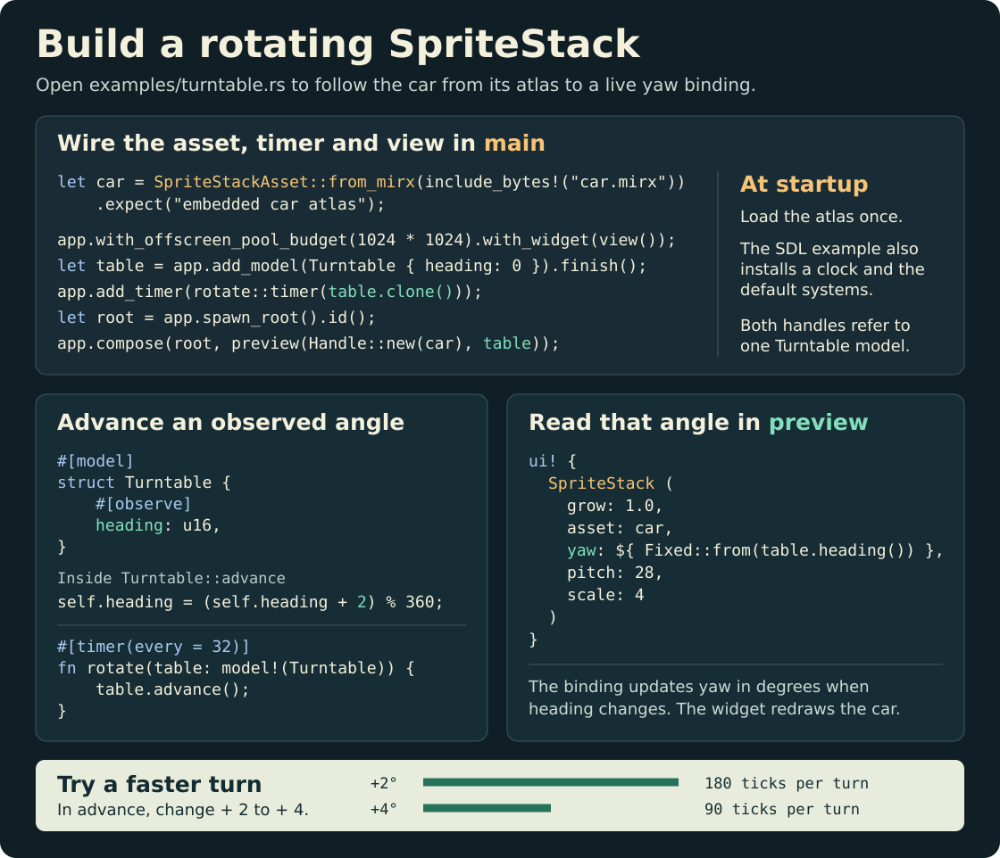

# SpriteStack

`mirui-sprite-stack` draws layered pixel art from a MIRX image atlas. Its optional `SSTK` chunk stores the order and spacing of the layers and their common pivot. An ordinary MIRX image viewer can open the same file.


## Try it

Run the SDL turntable from the Mirui checkout:

```sh
cargo run -p mirui-sprite-stack --example turntable --features mirui/sdl
```

<details>
<summary>Build a rotating car from an observed angle</summary>



Open [turntable.rs](examples/turntable.rs) and change `+ 2` to `+ 4` in `Turntable::advance`. Run the same command again. The car completes a turn in 90 timer callbacks instead of 180. To change the viewing angle independently, edit `pitch` in `preview`.

</details>

The turntable includes a [car model](examples/car.obj) and its [prebuilt atlas](examples/car.mirx). To make another asset with ICU:

```sh
icu convert car.obj -F mirx --resolution 32 -O models
icu convert base.png body.png roof.png -F mirx --layers -O models
icu show models/car.mirx
```

PNG layers are ordered from bottom to top. Each layer uses the same canvas size and fully opaque or fully transparent pixels.

## Use in an application

For an application next to a Mirui checkout named `mirui`, add the dependencies explicitly:

```toml
[dependencies]
mirui = { path = "../mirui", default-features = false }
mirui-sprite-stack = { path = "../mirui/extensions/sprite-stack" }
```

Load the embedded asset once, register the extension's view, and pass the shared handle to a composition:

```rust
use mirui::core::cache::Handle;
use mirui::prelude::*;
use mirui_sprite_stack::{SpriteStack, SpriteStackAsset};

#[compose]
fn vehicle(car: Handle<SpriteStackAsset>, heading: Signal<Fixed>) -> Entity {
    ui! {
        SpriteStack(asset: car, yaw: ${ heading.get() }, pitch: 30, width: 96, height: 80)
    }
}

// During App setup:
let car = Handle::new(SpriteStackAsset::from_mirx(include_bytes!("vehicle.mirx"))?);
app.with_offscreen_pool_budget(64 * 1024);
app.with_widget(mirui_sprite_stack::view());
app.compose(root, vehicle(car, heading));
```

`yaw` and `pitch` use degrees. Positive pitch looks down on the layers; zero shows their edges. Omit `layer_spacing` to use the distance saved with the asset. The sprite uses the App's shared offscreen budget. A 96×80 RGBA output at 1× scale uses 30,720 bytes for its pixels.

Tools and build scripts can depend directly on [mirui-sprite-stack-format](format) and use `StackDescriptor` to read or write layer placement. The format crate depends only on `mirx`. The widget exposes the same types in its `format` module.

## Shared scenes

Register `SpriteStackPlugin`, place shared assets in a `StackScene`, and pass its Model handle to each viewport. The camera uses degrees and world units. A moving object can drive a chase camera while an overhead viewport shows the same game state.

```rust
use mirui::prelude::*;
use mirui_sprite_stack::{Camera, Object, StackScene, StackViewport};

#[mirui::compose]
fn screens(scene: model!(StackScene), player: Object) -> Entity {
    ui! {
        Row(grow: 1.0) {
            StackViewport(scene: scene.clone(), camera: Camera::chase(player), grow: 1.0)
            StackViewport(scene: scene, camera: Camera::overhead(), width: 80, height: 80)
        }
    }
}
```

`StackScene::bounded(n)` prepares instance slots. `place` accepts a shared sprite, a static prepared model, a height field, or a registered editable height field. A failed placement preserves existing objects. `set_pose`, `remove` and `height_at` use the returned `Object`. Use `Geometry::Sampled(&MODEL)` for a prepared model drawn as projected samples. Placing `&MODEL` directly draws the cell faces.

`StackViewport` selects detail separately for each camera. It uses the coarsest stored grid step that projects to at most one screen pixel, and draws the base atlas at closer scales. Optional `SLOD` records borrow sparse cells and their original RGBA colors or palette indices from the MIRX file. A coarse cell on the edge stops at the original layer bounds.

For a perspective chase view, set `Camera { focal_distance: Some(96.into()), ..Camera::chase(player) }`. The target plane keeps the configured scale. At 96 world units behind that plane, an object appears half as large. A second viewport can use `Camera::overhead()` to see the same objects at a constant scale.

[Passing Lane](examples/passing_lane.rs) starts two cars driving in separate lanes. One game timer advances both cars, and each time the faster car overtakes the slower one, the counter goes up. **Pause** and **Resume** control the race. **Toggle lift** raises or lowers a section of the repeating road. Both cameras show the same traffic and terrain, and `scene.height_at` keeps the cars on the road surface.

```sh
cargo run -p mirui-sprite-stack --example passing_lane --features mirui/sdl
```

Procedural games can pass their existing height and material planes to `HeightField::from_planes`. Use `with_coordinate_map` to convert local X/Z coordinates to the source map's axes. `address_at` returns the index for reading both planes.

### Game-directed cameras

[Pixel Flight](../../gallery/pixel-flight/src/runtime.rs) installs its animated flight camera with `StackViewport::with_renderer(scene, renderer)`. The renderer specifies the frame size and draws into the frame borrowed by `SceneRenderer::render`. Report an opaque byte limit to let Mirui choose a format within that limit, or use the default RGBA frame. The viewport owns the texture, assigns its revision and requests a new image when the scene, camera or viewport size changes. Setting the viewport's `camera` property selects the built-in camera. Additional viewports can follow the same objects independently.

Use `SceneRenderer::prepare_frame` for resources that need temporary storage during construction. It runs before the viewport allocates a new frame, so the temporary storage can be released first.

`ObjectPass::prepare` resolves placed objects for a view. Its result draws into each visible region using the scene depth buffer. `ProjectedStack` accepts per-layer offsets and a material callback for animated, shaded sprites. `TerrainView` draws a height field directly or accepts a `TerrainSurface` for procedural shading. `CameraWorkspace` handles screen roll, bounded tiles and optional opaque overlays. Its final callback draws into the current region before Mirui writes the target pixels. Pixel Flight supplies its controls, camera motion, sky, aircraft materials, exhaust and cockpit through these interfaces.
