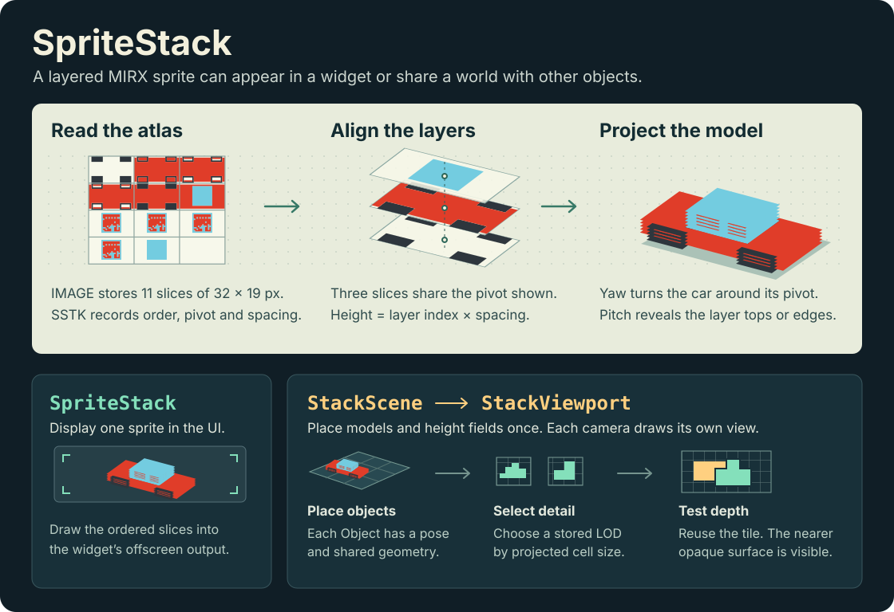

# SpriteStack

`mirui-sprite-stack` draws layered pixel art from a MIRX image atlas. Its optional `SSTK` chunk stores the order and spacing of the layers and their common pivot. An ordinary MIRX image viewer can open the same file.



## Try it

Run the SDL turntable from the Mirui checkout:

```sh
cargo run -p mirui-sprite-stack --example turntable --features mirui/sdl
```

<details>
<summary>Build a rotating car from an observed angle</summary>


Open [turntable.rs](examples/turntable.rs) and change `+ 2` to `+ 4` in `Turntable::advance`. Run the same command again. The car completes a turn in 90 timer callbacks instead of 180. To change the viewing angle independently, edit `pitch` in `preview`.

</details>

The turntable includes a [car model](examples/car.obj) and its [prebuilt atlas](examples/car.mirx). To make another asset with ICU:

```sh
icu convert car.obj -F mirx --resolution 32 -O models
icu convert base.png body.png roof.png -F mirx --layers -O models
icu show models/car.mirx
```

PNG layers are ordered from bottom to top. Each layer uses the same canvas size and fully opaque or fully transparent pixels.

## Use in an application

For an application next to a Mirui checkout named `mirui`, add the dependencies explicitly:

```toml
[dependencies]
mirui = { path = "../mirui", default-features = false }
mirui-sprite-stack = { path = "../mirui/extensions/sprite-stack" }
```

Load the embedded asset once, register the extension's view, and pass the shared handle to a composition:

```rust
use mirui::core::cache::Handle;
use mirui::prelude::*;
use mirui_sprite_stack::{SpriteStack, SpriteStackAsset};

#[compose]
fn vehicle(car: Handle<SpriteStackAsset>, heading: Signal<Fixed>) -> Entity {
    ui! {
        SpriteStack(asset: car, yaw: ${ heading.get() }, pitch: 30, width: 96, height: 80)
    }
}

// During App setup:
let car = Handle::new(SpriteStackAsset::from_mirx(include_bytes!("vehicle.mirx"))?);
app.with_offscreen_pool_budget(64 * 1024);
app.with_widget(mirui_sprite_stack::view());
app.compose(root, vehicle(car, heading));
```

`yaw` and `pitch` use degrees. Positive pitch looks down on the layers; zero shows their edges. Omit `layer_spacing` to use the distance saved with the asset. The sprite uses the App's shared offscreen budget. A 96×80 RGBA output at 1× scale uses 30,720 bytes for its pixels.

Tools and build scripts can depend directly on [mirui-sprite-stack-format](format) and use `StackDescriptor` to read or write layer placement. The format crate depends only on `mirx`. The widget exposes the same types in its `format` module.

## Viewports for ECS stage members

| Type | When to use it |
| --- | --- |
| `StackStage` | Share members across cameras, including a main view and minimap. |
| `StackVisual` | Give an entity geometry, pose and material. |
| `StackViewport` | Show a stage using one camera. |
| `ViewportContent` / `FrameContent` | Prepare procedural surroundings or depth-dependent effects for one viewport. |
| `ViewportOverlay` / `FrameOverlay` | Add screen-space content such as a cockpit instrument panel. |
| `SpriteStackAsset` / `GeneratedStackAsset` | Load layered MIRX artwork or publish generated slices. |

Register `SpriteStackPlugin` and create a stage with `app.add_model(StackStage::bounded(capacity)).finish()`. Import `StackStageCommands` in systems that use `commands.stage(&stage)`. Call `spawn(bundle, visual)` to create a member or `attach(entity, visual)` for an existing entity. Create a static value with `StackVisual::new(asset).at(pose)` or bind the visual to an observed game Model with `StackVisual::from_model(model, visual)`.

```rust
use mirui::prelude::*;
use mirui_sprite_stack::{Camera, StackStage, StackViewport};

#[mirui::compose]
fn stage_views(stage: model!(StackStage)) -> Entity {
    ui! {
        Row(grow: 1.0) {
            StackViewport(stage: stage.clone(), grow: 1.0)
            StackViewport(stage: stage, camera: Camera::overhead(), width: 80, height: 80)
        }
    }
}
```

Each viewport uses its own camera and output frame. Closing a viewport releases that viewport's resources. `commands.stage(&destination).transfer(entity)` keeps the entity and its visual binding while changing the set of viewports that display it. `commands.remove::<StackVisual>(entity)` detaches the visual, and `commands.despawn(entity)` retires the entity.

Retiring a stage registration clears its viewports and releases their rendered frames. Members remain available to the game for transfer or removal.

A populated stage retains the App ownership of its members even if its Model value is registered again. Detach or transfer the remaining members in their original App before moving the empty stage to another App.

A model-bound visual follows its source incarnation. When a `ModelList` item is removed, the scene despawns an entity created with `spawn` or detaches the visual from an entity supplied with `attach`. List reordering preserves the existing visual bindings.

When a live height field used as geometry retires, its surface disappears from every viewport. The member stays attached, so a model-bound visual can resume drawing when the model selects another field.

An indexed sprite can use `StackVisual::new(asset).at(pose).with_palette(skin).with_flash(hit_flash)`. The borrowed palette must have the same number of entries as the indexed source. Its RGB values apply at every level of detail, with coverage determined by the source alpha. `with_flash` blends visible sprite colors toward white and accepts a `Fixed` amount from zero to one. A visual bound with `StackVisual::from_model` retains its last valid value if the Model supplies an incompatible palette.

### Camera and artwork

The camera uses degrees and world units. A camera can observe a game Model and follow the player's position, as shown in the [Flight minimap](../../gallery/pixel-flight/examples/minimap.rs).

`StackVisual::new` accepts a shared sprite, a static prepared model, a height field, or a registered editable height field. Use `Geometry::Sampled(&MODEL)` to draw the prepared model as projected samples. Passing `&MODEL` draws the cell faces.

`StackViewport` selects detail separately for each camera. It uses the coarsest stored grid step that projects to at most one screen pixel, and draws the base atlas at closer scales. Optional `SLOD` records borrow sparse cells and their original RGBA colors or palette indices from the MIRX file. A coarse cell on the edge stops at the original layer bounds.

Set `Camera::focal_distance` to use perspective. The plane at `Camera::center` keeps the configured scale. One focal distance behind that plane, an object appears half as large. A second viewport can use `Camera::overhead()` to see the same objects at a constant scale.

[Passing Lane](examples/passing_lane.rs) starts two cars driving in separate lanes. One game timer advances both cars, and each time the faster car overtakes the slower one, the counter goes up. **Pause** and **Resume** control the race. **Toggle lift** raises or lowers a section of the repeating road. The simulation and both cameras use the same height field.

`StackViewport(...) [ViewportOverlay::new(input, painter)]` composites a layer into one viewport's output. Implement `raster::FrameOverlay<T>` for the painter. Supply a value or a `Prop<T>` for observed inputs. The viewport prepares the painter with the output pixel size and available camera geometry, then borrows it across the scene's render regions. Pixel Flight's cockpit uses this attachment for its instrument panel and opaque region coverage.

```sh
cargo run -p mirui-sprite-stack --example passing_lane --features mirui/sdl
```

Procedural games can pass their existing height and material planes to `HeightField::from_planes`. Use `with_coordinate_map` to convert local X/Z coordinates to the source map's axes. `address_at` returns the index for reading both planes.

### Game-directed cameras

`StackViewport` renders at the logical viewport size by default. Use its `resolution` property with `Resolution::Integer` to limit raster dimensions and preserve whole-pixel scaling. `Resolution::fit` also supplies the placement used by `FrameSize::frame_point` for input mapping. [Pixel Flight](../../gallery/pixel-flight/src/runtime.rs) uses this policy with its animated flight camera. The viewport owns the texture, assigns its revision and requests a new image when the scene, camera or viewport size changes. Additional viewports can follow the same objects independently.

Attach `ViewportContent::from_model(&game, GameHandle::revision, content)` in the same component list as an optional `ViewportOverlay`. The `FrameContent<Game>` implementation provides the camera and prepares borrowed procedural layers and optional depth-dependent effects. The viewport renders those layers with its Stage members. The revision drives changes from the existing game Model.

```rust
ui! {
    StackViewport(stage: stage) [
        ViewportContent::from_model(&game, GameHandle::revision, landscape),
        ViewportOverlay::new(instrument_input, instruments),
    ]
}
```

The landscape implements `FrameContent<Game>`. The instrument painter implements `FrameOverlay<T>` for its input type. For fixed procedural content, use `ViewportContent::new(landscape)`. [Attachment test](tests/stage_content.rs) demonstrates replacement and removal.

`SceneLayers` defines terrain, background, objects, world effects and sprites. SpriteStack uses one tile order for color and depth sampling, applies the screen-space overlay, and publishes the resulting texture. Use `ViewportOutput::Bounded` to draw through a reusable working tile and an opaque output of at most two bytes per pixel.

`StackVisual::with_role::<T>()` identifies a field that a `FrameContent` implementation wants to shade. The viewport resolves its pose in `ContentFrame::terrain` and schedules the remaining members automatically. [Pixel Flight's attached content](../../gallery/pixel-flight/src/runtime/renderer.rs) prepares the landscape and exhaust. Its [stage system](../../gallery/pixel-flight/src/runtime/stage_members.rs) publishes aircraft placement and material.

### Generate or load a sprite

`SpriteStackAsset::from_mirx(bytes)` loads the MIRX image atlas and slice metadata. An open MIRX reader provides `sprite_stack()` through `SpriteStackReaderExt`. Pass a shared asset handle to `StackVisual::new`.

```rust
use mirui_sprite_stack::{GeneratedLevel, GeneratedStackAsset, StackSample, StackVisual};

fn generated_visual() -> Result<StackVisual, mirui_sprite_stack::GeneratedError> {
    let cell = StackSample { x: 0, y: 0, color: 0 };
    let level = GeneratedLevel::new(1, vec![0, 1], vec![cell]);
    let asset = GeneratedStackAsset::new(
        [1, 1, 1], [0; 3], 256, vec![[120, 200, 255, 255]], vec![level], 4096,
    )?;
    Ok(StackVisual::new(asset))
}
```

A model can publish a new generated asset through the same `StackVisual::from_model` binding. The initial build checks the storage budget and level data. [Generated asset integration test](tests/stage_generated.rs) exercises replacement and budget failure with two viewports.
