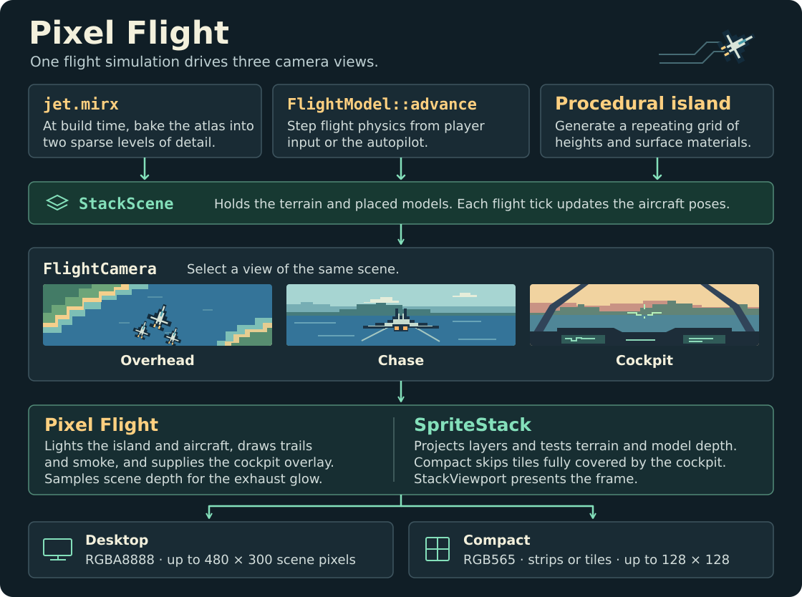
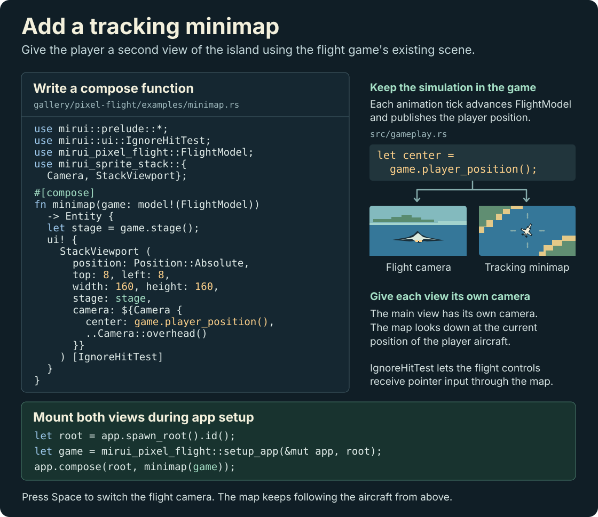

# Pixel Flight

Fly over procedural islands with overhead, chase and cockpit views. The game builds two levels of aircraft detail from [jet.mirx](assets/jet.mirx) and renders the scene with [SpriteStack](../../extensions/sprite-stack).

## Run the demo

Run the desktop version from the Mirui checkout:

```sh
cargo run -p gallery --example pixel_flight_demo --profile release-opt --no-default-features --features sdl-gpu,pixel-flight
```

Point to steer, click to roll, hold the pointer button or Shift to boost, and press Space to switch views. Both desktop and Compact support window resizing and the same controls.

Compact renders at native 128×128 with bounded scene tiles and lossless MIRX cockpit rows. Mirui selects the output format within a two-byte-per-pixel budget:

```sh
cargo run -p gallery --example pixel_flight_compact_demo --profile release-opt --no-default-features --features sdl-gpu,pixel-flight
```

Append `-- --auto` to either command for automatic flight with camera changes every twelve simulation seconds. In a `no_std` application, call `set_autoplay(true)` on the Model returned by `mirui_pixel_flight::setup_compact_app`. Passing `false` restores manual control without restarting the flight.

## How a frame is drawn

The flight model advances controls, aircraft and trail history. The stage system attaches the aircraft and ground as shared members. Each camera reads the same simulation. The attached `FrameContent` supplies the landscape and exhaust. SpriteStack projects the stage members using their material and pose. The cockpit builds its artwork on resize and reads the current flight state for its live instruments. [Model](src/gameplay/flight.rs) · [Camera](src/presentation/camera.rs) · [Stage system](src/presentation/stage.rs) · [Frame content](src/presentation/frame.rs) · [Layers](src/presentation/layers.rs) · [Artwork](src/presentation/hud/artwork.rs) · [Instruments](src/presentation/hud/instruments.rs)



Edit the RGB swatches in [atmosphere](src/presentation/palette/environment.rs), [terrain](src/presentation/palette/terrain.rs), and [aircraft](src/presentation/palette/aircraft.rs) to change the scene colors. The renderer reads palettes baked at compile time from these swatches.

## Add a tracking minimap



Run the [minimap example](examples/minimap.rs):

```sh
cargo run -p mirui-pixel-flight --example minimap --features mirui/sdl --profile release-opt
```

Press Space to switch the main camera. The inset keeps tracking the aircraft from above. Set the minimap camera's pitch to `Fixed::from_int(35)` for an angled view. Both viewports read the same [flight update](src/gameplay.rs) and [stage members](src/presentation/stage.rs).
